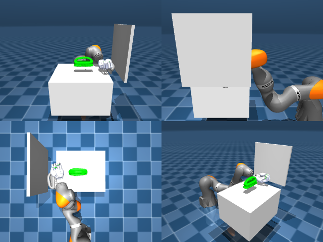

# Codex + GPT-6 Luna, reasoning effort xhigh, reasoning summaries on, 60 min, no per-goal time limit — dextoolbench_eraser_handle_eraser_wipe_c-limited

Run: Harbor job `dtbl-nt-gpt6luna-xhigh`, trial `dextoolbench_eraser_handle_erase__pLP8dRe`, 2026-09-29. Mode: **limited (robot as a service)**.

| | |
|---|---|
| result | **0** |
| agent time | 3602 s |
| actions / physics steps | — / — |
| tokens in / out | 34129881 / 147582 |
| verifier | `{"success": 0, "deterministic": 1, "finalized": 1, "control_steps": 13848, "calls": 230, "elapsed_s": 3691.0, "video_rendered": 1, "grader_error": 0, "progress": 0.0, "goals_reached": 0, "n_goals": 31, "failed_on_timeout": 0}` |
| verifier sandbox | separate |

## Replay (verifier's six-camera video)

[replay.mp4](replay.mp4) — top: world / observer / head; bottom: front / left wrist / right wrist.

## Agent's last messages

- I’m continuing from the current live pose and checking the actual loop position against the fingertips. The previous attempts have not registered a lift, so I’m switching to a small, observable repositioning attempt before spending more steps on another grasp.
- The hand has curled at the current alignment, but the eraser is still visibly on the table. I’m testing a small elbow lift while watching the eraser; if it stays fixed, I’ll treat that as a failed grasp and use the images to reposition the hand.
- The side views place the open fingertips a few centimeters from the loop. I’m shifting the wrist across that gap toward the eraser’s goal-facing edge, then I’ll close and check for actual object motion before lifting again.
