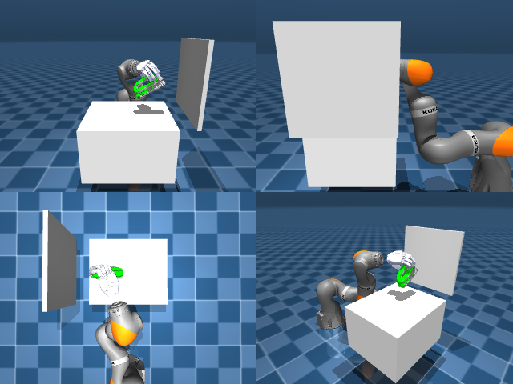

# Codex + GPT-6 Luna, reasoning effort xhigh, reasoning summaries on, 60 min — dextoolbench_eraser_handle_eraser_wipe_c

Run: Harbor job `mj-gpt6luna-xhigh`, trial `dextoolbench_eraser_handle_erase__qMK3Vyc`, 2026-09-28. Mode: **unlimited**.

| | |
|---|---|
| result | **0** |
| agent time | 3602 s |
| actions / physics steps | 1023 / — |
| tokens in / out | 11215825 / 117973 |
| verifier | `{"success": 0, "progress": 0.1935, "goals_reached": 6, "n_goals": 31, "failed_on_timeout": 0, "deterministic": 1, "n_actions": 1023, "control_steps_used": 1023, "video_rendered": 1, "grader_error": 0, "agent_resets": 1262, "agent_control_steps": 472651, "agent_cost_self_reported": 1, "agent_traces": 300, "agent_trace_videos": 6}` |
| verifier sandbox | separate |

Debugging footprint (self-reported by the agent's tooling log): 92 sessions, 1262 resets, None physics steps.

## Replay (verifier's six-camera video)

[replay.mp4](replay.mp4) — top: world / observer / head; bottom: front / left wrist / right wrist.

## Agent's last messages

- The controller now reaches goal 1 in simulation. I’m checking whether the eraser stays in the hand after that transient lift; the rest of the path depends on maintaining the grasp as the tool travels.
- I’ve found a trajectory that reaches the first two goals. I’m continuing from that recorded state and checking whether the same contact-based controller can carry the eraser through the next points.
- The full generator is now advancing goal by goal, using a short pose search when the nominal IK motion misses. It’s taking longer on goals where the eraser contact needs adjustment; I’m monitoring the replay score and will keep the best trajectory it reaches.
