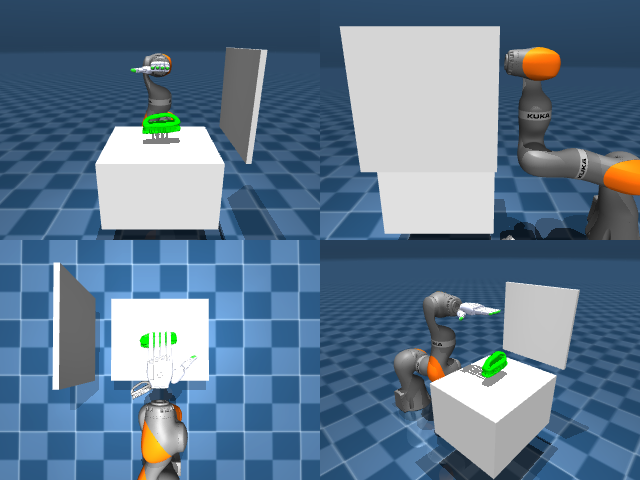

# Codex + GPT-6 Luna, reasoning effort xhigh, reasoning summaries on, 60 min, no per-goal time limit — dextoolbench_eraser_handle_eraser_wipe_smile-limited

Run: Harbor job `dtbl-nt-gpt6luna-xhigh`, trial `dextoolbench_eraser_handle_erase__F9KkbQ9`, 2026-09-29. Mode: **limited (robot as a service)**.

| | |
|---|---|
| result | **0** |
| agent time | 3359 s |
| actions / physics steps | — / — |
| tokens in / out | 23829406 / 149457 |
| verifier | `{"success": 0, "deterministic": 1, "finalized": 1, "control_steps": 36000, "calls": 268, "elapsed_s": 3379.2, "video_rendered": 1, "grader_error": 0, "progress": 0.0, "goals_reached": 0, "n_goals": 29, "failed_on_timeout": 0}` |
| verifier sandbox | separate |

## Replay (verifier's six-camera video)

[replay.mp4](replay.mp4) — top: world / observer / head; bottom: front / left wrist / right wrist.

## Agent's last messages

- The arm now stays within the reachable workspace, but repeated contact, pinch, hook, and lift attempts still leave the object on the table. I’m using the remaining episode steps for one final small elbow adjustment at the verified contact height, then I’ll let the service finalize the trajectory.
- The elbow adjustment also failed to lift the eraser. The service is still active at 18,960 of 36,000 control steps with 0 goals reached. I’m parking the open hand above the table and advancing the remaining steps so the episode is finalized and graded.
- The episode ended at the 36,000-step limit with **0 of 29 goals reached** (score **0/29**). I couldn’t secure the eraser; lift checks showed it remained on the table.  I saved the camera- and proprioception-based controller record at [gen.py](/app/output/gen.py).
