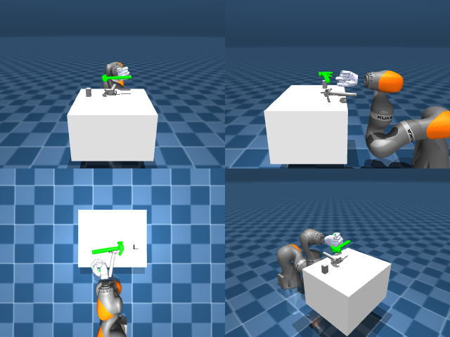

# Codex + GPT-6 Luna, reasoning effort xhigh, reasoning summaries on, 60 min, no per-goal time limit — dextoolbench_hammer_claw_hammer_swing_down-limited

Run: Harbor job `dtbl-nt-gpt6luna-xhigh`, trial `dextoolbench_hammer_claw_hammer__z3GhDE5`, 2026-09-29. Mode: **limited (robot as a service)**.

| | |
|---|---|
| result | **0** |
| agent time | 3602 s |
| actions / physics steps | — / — |
| tokens in / out | 26062129 / 123960 |
| verifier | `{"success": 0, "deterministic": 1, "finalized": 1, "control_steps": 8436, "calls": 165, "elapsed_s": 3765.8, "video_rendered": 1, "grader_error": 0, "progress": 0.0, "goals_reached": 0, "n_goals": 37, "failed_on_timeout": 0}` |
| verifier sandbox | separate |

## Replay (verifier's six-camera video)

[replay.mp4](replay.mp4) — top: world / observer / head; bottom: front / left wrist / right wrist.

## Agent's last messages

- The hand is now hovering over the hammer handle in the front and side views. I’m closing the thumb and four fingers around it with the arm held still, then I’ll check whether the hammer follows before lifting.
- The first closure did not lift the hammer; it stayed on the table during the lift check. I’m repositioning slightly lower and will retry with a tighter thumb opposition and finger curl, using the side and front views to confirm contact.
- The depth geometry shows why the earlier lifts missed: the fingers were contacting the tabletop beside the handle. I’m correcting the grasp point slightly toward the hammer and raising the fingertips off the table before closing again.
