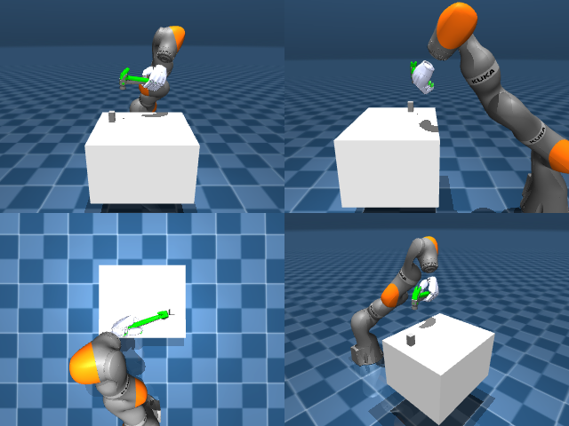

# Codex + GPT-6 Luna, reasoning effort xhigh, reasoning summaries on, 60 min — dextoolbench_hammer_claw_hammer_swing_down

Run: Harbor job `mj-gpt6luna-xhigh`, trial `dextoolbench_hammer_claw_hammer__5E9Lg5q`, 2026-09-29. Mode: **unlimited**.

| | |
|---|---|
| result | **0** |
| agent time | 3227 s |
| actions / physics steps | 1386 / — |
| tokens in / out | 15586907 / 136756 |
| verifier | `{"success": 0, "progress": 0.3243, "goals_reached": 12, "n_goals": 37, "failed_on_timeout": 0, "deterministic": 1, "n_actions": 1386, "control_steps_used": 1386, "video_rendered": 1, "grader_error": 0, "agent_resets": 99, "agent_control_steps": 66575, "agent_cost_self_reported": 1, "agent_traces": 55, "agent_trace_videos": 3, "agent_trace_videos_skipped_budget": 1}` |
| verifier sandbox | separate |

Debugging footprint (self-reported by the agent's tooling log): 75 sessions, 99 resets, None physics steps.

## Replay (verifier's six-camera video)

[replay.mp4](replay.mp4) — top: world / observer / head; bottom: front / left wrist / right wrist.

## Agent's last messages

- The feedback controller now carries the hammer close enough to register the first goal. I’m turning that calibrated grasp and pose controller into `/app/output/gen.py`, then I’ll record a full trajectory and check how many ordered goals it reaches.
- The recorded replay now reaches five ordered goals. The first four mostly need translation; the next poses require more rotation, so I’m tuning that rotation gradually while preserving the already-working lift and early swing.
- Created the trajectory and generator:  - [trajectory.npz](/app/output/trajectory.npz) — shape **(1386, 29)** - [gen.py](/app/output/gen.py)  Replay reached **12 of 37 goals** (**0.324 reward**). The remaining goals were not reached.
