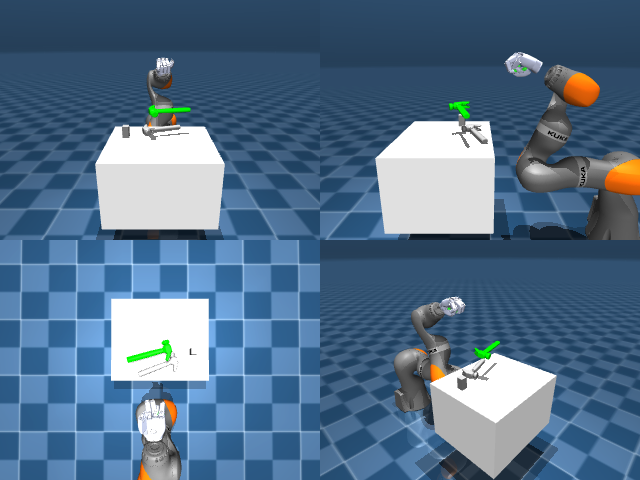

# Codex + GPT-6 Luna, reasoning effort xhigh, reasoning summaries on, 60 min — dextoolbench_hammer_claw_hammer_swing_side-limited

Run: Harbor job `mjl-gpt6luna-xhigh`, trial `dextoolbench_hammer_claw_hammer__A4aV2Cn`, 2026-09-29. Mode: **limited (robot as a service)**.

| | |
|---|---|
| result | **0** |
| agent time | 1260 s |
| actions / physics steps | — / — |
| tokens in / out | 6044114 / 58458 |
| verifier | `{"success": 0, "deterministic": 1, "finalized": 1, "control_steps": 600, "calls": 60, "elapsed_s": 1243.2, "video_rendered": 1, "grader_error": 0, "progress": 0.0, "goals_reached": 0, "n_goals": 40, "failed_on_timeout": 1}` |
| verifier sandbox | separate |

## Replay (verifier's six-camera video)

[replay.mp4](replay.mp4) — top: world / observer / head; bottom: front / left wrist / right wrist.

## Agent's last messages

- The lift test showed the hammer stayed on the table. The closer images reveal the fingertips were still above the handle, so I’m lowering the closed hand further over the shaft before retrying the lift.
- The first goal has not advanced; the hammer remained on the table during the lift attempts. I’m saving the action and observation workflow to `/app/output/gen.py`, then I’ll let the current goal finish so the recorded episode closes cleanly.
- The episode ended on a timeout at goal 0: **0/40 goals reached**. The hammer stayed on the table during the lift attempts.  I saved the camera and proprioception based action sequence in [gen.py](/app/output/gen.py).
