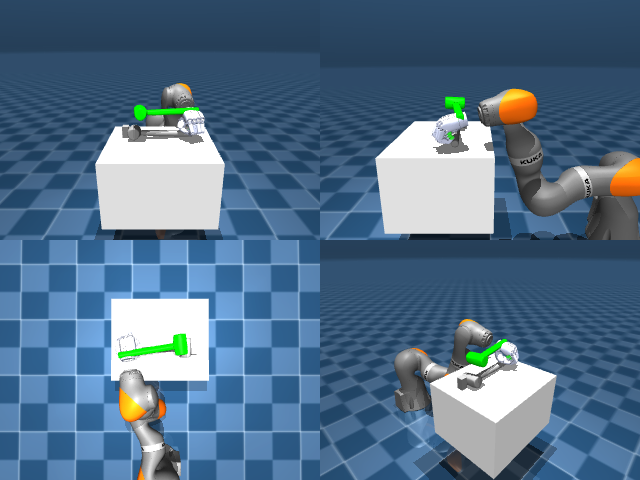

# Codex + GPT-6 Luna, reasoning effort xhigh, reasoning summaries on, 60 min — dextoolbench_hammer_mallet_hammer_swing_down-limited

Run: Harbor job `mjl-gpt6luna-xhigh`, trial `dextoolbench_hammer_mallet_hamme__sXVzAMR`, 2026-09-29. Mode: **limited (robot as a service)**.

| | |
|---|---|
| result | **0** |
| agent time | 1064 s |
| actions / physics steps | — / — |
| tokens in / out | 2620230 / 40602 |
| verifier | `{"success": 0, "deterministic": 1, "finalized": 1, "control_steps": 600, "calls": 50, "elapsed_s": 948.2, "video_rendered": 1, "grader_error": 0, "progress": 0.0, "goals_reached": 0, "n_goals": 36, "failed_on_timeout": 1}` |
| verifier sandbox | separate |

## Replay (verifier's six-camera video)

[replay.mp4](replay.mp4) — top: world / observer / head; bottom: front / left wrist / right wrist.

## Agent's last messages

- I’ve reached the end of the first goal’s 10-second window without a confirmed pickup; the latest RGB-D frames still show the mallet on the tabletop. I’m using the final available control steps for one brief lift attempt, then I’ll save the run controller and the episode result.
- The episode ended on goal 0 with 0 of 36 goals reached. I’m writing the requested `gen.py` now as a reproducible record of the camera-guided joint commands and visual calibration probes; it checks for an already finished episode before submitting anything.
- The episode ended at step 600 on goal 0 with **0 of 36 goals reached** (score 0). The mallet remained on the table, so the pickup did not succeed.  I saved the controller record at [gen.py](/app/output/gen.py) and the terminal episode metadata at [meta.json](/app/output/episode_end/meta.json). The episode has ended, and the no-reset rule prevents another attempt.
