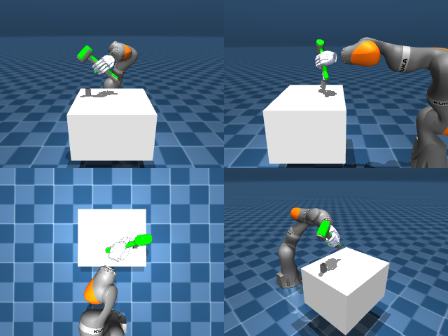

# Codex + GPT-6 Luna, reasoning effort xhigh, reasoning summaries on, 60 min — dextoolbench_hammer_mallet_hammer_swing_down

Run: Harbor job `mj-gpt6luna-xhigh`, trial `dextoolbench_hammer_mallet_hamme__NG96xxD`, 2026-09-29. Mode: **unlimited**.

| | |
|---|---|
| result | **1 (success)** |
| agent time | 1688 s |
| actions / physics steps | 4048 / — |
| tokens in / out | 3011296 / 60172 |
| verifier | `{"success": 1, "progress": 1.0, "goals_reached": 36, "n_goals": 36, "failed_on_timeout": 0, "deterministic": 1, "n_actions": 4048, "control_steps_used": 4048, "video_rendered": 1, "grader_error": 0, "agent_resets": 76, "agent_control_steps": 31871, "agent_cost_self_reported": 1, "agent_traces": 28, "agent_trace_videos": 6}` |
| verifier sandbox | separate |

Debugging footprint (self-reported by the agent's tooling log): 71 sessions, 76 resets, None physics steps.

## Replay (verifier's six-camera video)

[replay.mp4](replay.mp4) — top: world / observer / head; bottom: front / left wrist / right wrist.

## Agent's last messages

- The first grasp can lift the hammer, but it slips and twists enough that the first goal times out. I’m changing the approach to a top down grasp and checking its lift stability before running the full pose sequence.
- A slower, segmented wrist move plus one correction from the measured hand to hammer transform reached goal 0 in simulation. I’m applying that same feedback loop goal by goal and will save the recorded joint targets, then replay them from the frozen start.
- Completed the hammer swing trajectory. The replay reached **all 36 goals**.  - [trajectory.npz](/app/output/trajectory.npz) — shape `(4048, 29)`, recorded at 60 Hz - [gen.py](/app/output/gen.py) — controller and trajectory generator  The saved trajectory replayed successfully from the frozen start state.
