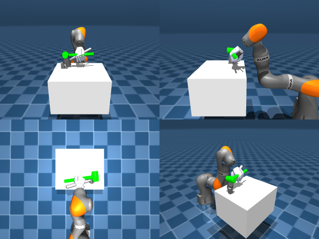

# Codex + GPT-6 Luna, reasoning effort xhigh, reasoning summaries on, 60 min — dextoolbench_hammer_mallet_hammer_swing_side-limited

Run: Harbor job `mjl-gpt6luna-xhigh`, trial `dextoolbench_hammer_mallet_hamme__4LHS5Uz`, 2026-09-29. Mode: **limited (robot as a service)**.

| | |
|---|---|
| result | **0** |
| agent time | 1312 s |
| actions / physics steps | — / — |
| tokens in / out | 3718900 / 56051 |
| verifier | `{"success": 0, "deterministic": 1, "finalized": 1, "control_steps": 600, "calls": 44, "elapsed_s": 1279.0, "video_rendered": 1, "grader_error": 0, "progress": 0.0, "goals_reached": 0, "n_goals": 32, "failed_on_timeout": 1}` |
| verifier sandbox | separate |

## Replay (verifier's six-camera video)

[replay.mp4](replay.mp4) — top: world / observer / head; bottom: front / left wrist / right wrist.

## Agent's last messages

- The lift check shows the mallet stayed on the table, so the fingertips were still just above the handle. I’m lowering slightly with the hand closed to make contact, then I’ll retry a gentle lift and verify that the tool moves with the hand.
- The handle still appears stationary. I corrected the finger-joint indexing and tightened the grasp; the fingers remain just above the shaft. I’m using the remaining downward range in the arm to bring the fingertips into contact, then I’ll test the grip once more.
- The episode timed out at goal 0. The service reported `goals_reached: 0` and `failed_on_timeout: true`; the mallet was lifted briefly but did not reach the goal tolerance.  I saved the controller at [gen.py](/app/output/gen.py) and confirmed it compiles.
