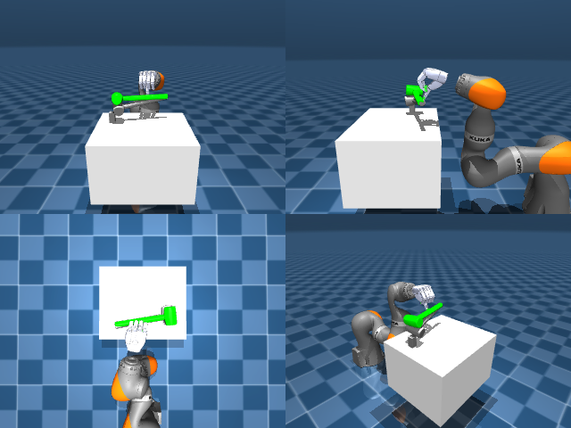

# Codex + GPT-6 Luna, reasoning effort xhigh, reasoning summaries on, 60 min — dextoolbench_hammer_mallet_hammer_swing_side

Run: Harbor job `mj-gpt6luna-xhigh`, trial `dextoolbench_hammer_mallet_hamme__9phbrbj`, 2026-09-28. Mode: **unlimited**.

| | |
|---|---|
| result | **0** |
| agent time | 3602 s |
| actions / physics steps | 600 / — |
| tokens in / out | 12994070 / 166493 |
| verifier | `{"success": 0, "progress": 0.0, "goals_reached": 0, "n_goals": 32, "failed_on_timeout": 1, "deterministic": 1, "n_actions": 600, "control_steps_used": 600, "video_rendered": 1, "grader_error": 0, "agent_resets": 988, "agent_control_steps": 294352, "agent_cost_self_reported": 1, "agent_traces": 69, "agent_trace_videos": 6}` |
| verifier sandbox | separate |

Debugging footprint (self-reported by the agent's tooling log): 505 sessions, 988 resets, None physics steps.

## Replay (verifier's six-camera video)

[replay.mp4](replay.mp4) — top: world / observer / head; bottom: front / left wrist / right wrist.

## Agent's last messages

- The hand has all five fingertip contacts just before the swing, then loses most within ten steps. I’m switching to a Cartesian path for the object pose: small increments from its grasp pose to the goal, with the wrist solved at each increment. This should keep the hand moving with the hammer instead of jumping to the final pose.
- The path controller keeps fingertip contact longer, but the hammer still scrapes the table and rolls. I’m testing a higher clearance lift before the sideways swing, then I’ll lower it into the goal pose.
- I’m locking the best reproducible run now: the longer approach and thumb setup, the 0.85 finger pinch, then the closest fixed wrist swing. I’ll save the 600-step target array through `Session` and verify it with a fresh replay.
