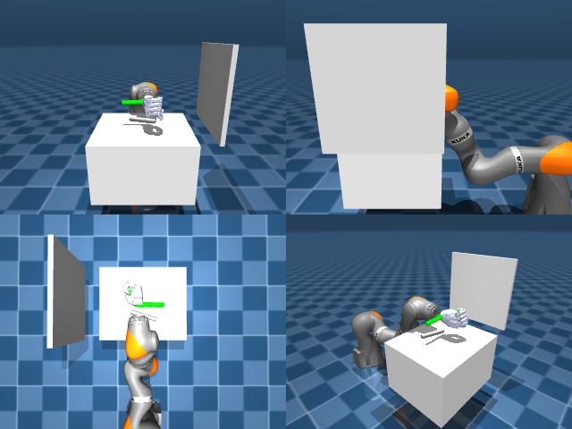

# Codex + GPT-6 Luna, reasoning effort xhigh, reasoning summaries on, 60 min, no per-goal time limit — dextoolbench_marker_sharpie_marker_draw_smile-limited

Run: Harbor job `dtbl-nt-gpt6luna-xhigh`, trial `dextoolbench_marker_sharpie_mark__igaPu8P`, 2026-09-29. Mode: **limited (robot as a service)**.

| | |
|---|---|
| result | **0** |
| agent time | 3602 s |
| actions / physics steps | — / — |
| tokens in / out | 18355117 / 130942 |
| verifier | `{"success": 0, "deterministic": 1, "finalized": 1, "control_steps": 6951, "calls": 295, "elapsed_s": 3689.4, "video_rendered": 1, "grader_error": 0, "progress": 0.0, "goals_reached": 0, "n_goals": 36, "failed_on_timeout": 0}` |
| verifier sandbox | separate |

## Replay (verifier's six-camera video)

[replay.mp4](replay.mp4) — top: world / observer / head; bottom: front / left wrist / right wrist.

## Agent's last messages

- The quick joint moves showed that frames captured at the end of a command can lag the arm state. I’ve returned to the starting joint pose and am letting each small move settle before measuring it; this should give a usable camera-based motion map without contacting the marker.
- The arm is now directly over the marker, with the open fingertips at tabletop height. I’ll curl the hand gradually around it and check the camera view before lifting, since the marker is still resting on the table.
- The first lowering attempt reached the tabletop before the fingers could curl, so the marker stayed put. I’ve reopened and lifted the hand clear; I’m going to try the intermediate height where the fingers can close around the marker without pressing into the table.
