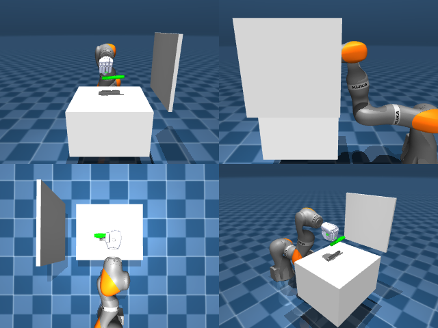

# Codex + GPT-6 Luna, reasoning effort xhigh, reasoning summaries on, 60 min — dextoolbench_marker_sharpie_marker_write_c-limited

Run: Harbor job `mjl-gpt6luna-xhigh`, trial `dextoolbench_marker_sharpie_mark__Qs57JjE`, 2026-09-29. Mode: **limited (robot as a service)**.

| | |
|---|---|
| result | **0** |
| agent time | 1346 s |
| actions / physics steps | — / — |
| tokens in / out | 2744490 / 47297 |
| verifier | `{"success": 0, "deterministic": 1, "finalized": 1, "control_steps": 600, "calls": 24, "elapsed_s": 1325.5, "video_rendered": 1, "grader_error": 0, "progress": 0.0, "goals_reached": 0, "n_goals": 25, "failed_on_timeout": 1}` |
| verifier sandbox | separate |

## Replay (verifier's six-camera video)

[replay.mp4](replay.mp4) — top: world / observer / head; bottom: front / left wrist / right wrist.

## Agent's last messages

- The marker is about 10 cm below and slightly forward of the hand’s fingertips. Small joint probes show joint 4 lowers the hand, while joint 2 can partly offset the sideways drift. I’m starting a slow lowering reach and will remeasure before closing the fingers.
- The hand reached the tabletop, but the marker stayed on the table through the lift attempts. The episode has now timed out at goal 0 (0/25). I’m saving the controller and its action sequence to `/app/output/gen.py` as requested.
- The episode timed out on goal 0, so the recorded score is **0/25**. The hand reached the tabletop, but the marker remained there during the lift attempts.  I saved the action script at [gen.py](/app/output/gen.py) and the final episode result at [meta.json](/app/output/final_attempt/meta.json).
