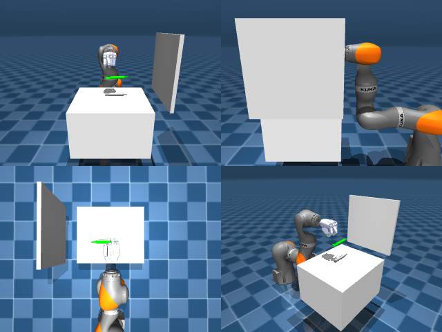

# Codex + GPT-6 Luna, reasoning effort xhigh, reasoning summaries on, 60 min — dextoolbench_marker_staples_marker_draw_smile-limited

Run: Harbor job `mjl-gpt6luna-xhigh`, trial `dextoolbench_marker_staples_mark__vUtN6Df`, 2026-09-29. Mode: **limited (robot as a service)**.

| | |
|---|---|
| result | **0** |
| agent time | 782 s |
| actions / physics steps | — / — |
| tokens in / out | 1404850 / 27327 |
| verifier | `{"success": 0, "deterministic": 1, "finalized": 1, "control_steps": 600, "calls": 36, "elapsed_s": 722.8, "video_rendered": 1, "grader_error": 0, "progress": 0.0, "goals_reached": 0, "n_goals": 49, "failed_on_timeout": 1}` |
| verifier sandbox | separate |

## Replay (verifier's six-camera video)

[replay.mp4](replay.mp4) — top: world / observer / head; bottom: front / left wrist / right wrist.

## Agent's last messages

- The marker stayed on the table during that lift, so the first close missed. I’m resetting just the hand posture (without resetting the scene): open above the marker, lower with the fingers spread, then close around it. The goal clock is still running, with about 7 seconds remaining for this pose.
- The pen remains on the tabletop through the lift, so the grasp attempt failed. Only three control steps remain on goal 0; I’ll let the episode record its timeout, then save the attempted controller and its action sequence in `/app/output/gen.py`.
- The episode ended at the goal 0 timeout with **0/49 goals reached**. The marker stayed on the table during the lift attempts, so the grasp failed.  I saved the attempted controller at [gen.py](/app/output/gen.py) and the final episode record at [meta.json](/app/output/episode_end/meta.json). The service used all 600 control steps.
