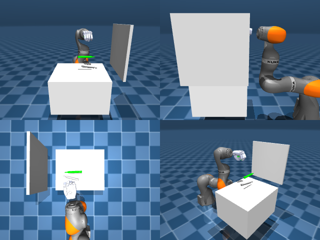

# Codex + GPT-6 Luna, reasoning effort xhigh, reasoning summaries on, 60 min, no per-goal time limit — dextoolbench_marker_staples_marker_write_c-limited

Run: Harbor job `dtbl-nt-gpt6luna-xhigh`, trial `dextoolbench_marker_staples_mark__AwNH8He`, 2026-09-29. Mode: **limited (robot as a service)**.

| | |
|---|---|
| result | **0** |
| agent time | 3412 s |
| actions / physics steps | — / — |
| tokens in / out | 21681168 / 118222 |
| verifier | `{"success": 0, "deterministic": 1, "finalized": 1, "control_steps": 10434, "calls": 214, "elapsed_s": 3491.5, "video_rendered": 1, "grader_error": 0, "progress": 0.0, "goals_reached": 0, "n_goals": 29, "failed_on_timeout": 0}` |
| verifier sandbox | separate |

## Replay (verifier's six-camera video)

[replay.mp4](replay.mp4) — top: world / observer / head; bottom: front / left wrist / right wrist.

## Agent's last messages

- I’ve used the remaining live attempts to check overhead and side pinches. The marker kept resting on the table during each lift, so no pose goal has registered yet. I’m saving the camera/proprioception controller and the episode artifacts at the requested path.
- The service reports 10,206 control steps and 0/29 goals reached, with about 224 seconds left in its wall-clock budget. I’m making one last short grasp/lift attempt, then I’ll leave the controller and latest observation saved.
- The marker never stayed in the hand during a lift, so **no goals were reached**.  The last service status was **0/29 goals**, 10,434 control steps, `done: false`, with about 165 seconds left. The episode trajectory remains in the service.  I saved the controller at [gen.py](/app/output/gen.py), the status at [episode_summary.json](/app/output/episode_summary.json), and the latest camera observation at [final_state](/app/output/final_state/meta.json).
