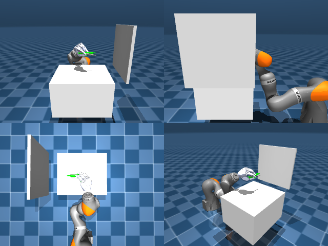

# Codex + GPT-6 Luna, reasoning effort xhigh, reasoning summaries on, 60 min — dextoolbench_marker_staples_marker_write_c

Run: Harbor job `mj-gpt6luna-xhigh`, trial `dextoolbench_marker_staples_mark__WwGJwAK`, 2026-09-29. Mode: **unlimited**.

| | |
|---|---|
| result | **0** |
| agent time | 3602 s |
| actions / physics steps | 1021 / — |
| tokens in / out | 13719330 / 159116 |
| verifier | `{"success": 0, "progress": 0.0345, "goals_reached": 1, "n_goals": 29, "failed_on_timeout": 1, "deterministic": 1, "n_actions": 1021, "control_steps_used": 1021, "video_rendered": 1, "grader_error": 0, "agent_resets": 550, "agent_control_steps": 130103, "agent_cost_self_reported": 1, "agent_traces": 300, "agent_trace_videos": 6}` |
| verifier sandbox | separate |

Debugging footprint (self-reported by the agent's tooling log): 82 sessions, 550 resets, None physics steps.

## Replay (verifier's six-camera video)

[replay.mp4](replay.mp4) — top: world / observer / head; bottom: front / left wrist / right wrist.

## Agent's last messages

- The cause was the hand’s actuator limits: the search let `Session.step()` clip each interpolated closing target, while the producer clipped the final hand pose before interpolation. That changed the fingers’ closing path and lost the grasp. I’m matching the search’s per-step clipping behavior and rerunning the recorded controller.
- The remaining difference was a one-bit coordinate discrepancy: the search computed the approach height as `z + 0.08`, while the producer had rounded that sum into a separate literal. It changed contact behavior despite visually identical targets. The pick action rows now match the successful rollout exactly; I’m replaying the full controller with that corrected path.
- The exact recorded replay reaches goal 0, then stalls just outside goal 1’s tolerance (3.4 cm keypoint error) until its 10-second timeout. I’m tuning the next-goal controller from the replayed goal-0 state and will keep the verified prefix fixed.
