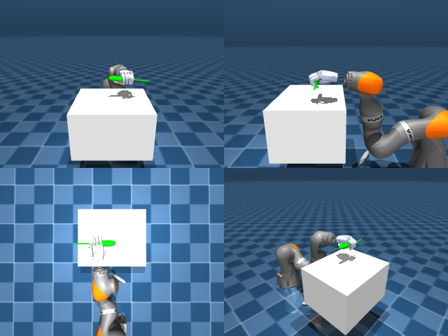

# Codex + GPT-6 Luna, reasoning effort xhigh, reasoning summaries on, 60 min, no per-goal time limit — dextoolbench_screwdriver_long_screwdriver_spin_horizontal-limited

Run: Harbor job `dtbl-nt-gpt6luna-xhigh`, trial `dextoolbench_screwdriver_long_sc__srQDV5X`, 2026-09-29. Mode: **limited (robot as a service)**.

| | |
|---|---|
| result | **0** |
| agent time | 3602 s |
| actions / physics steps | — / — |
| tokens in / out | 21540618 / 137014 |
| verifier | `{"success": 0, "deterministic": 1, "finalized": 1, "control_steps": 7062, "calls": 119, "elapsed_s": 3737.8, "video_rendered": 1, "grader_error": 0, "progress": 0.0, "goals_reached": 0, "n_goals": 31, "failed_on_timeout": 0}` |
| verifier sandbox | separate |

## Replay (verifier's six-camera video)

[replay.mp4](replay.mp4) — top: world / observer / head; bottom: front / left wrist / right wrist.

## Agent's last messages

- The depth reconstruction gives a usable direction: a small yaw change aligns the finger span with the handle, while a coordinated shoulder and elbow move carries the fingertips toward the tool and down. I’ll advance in short increments and recheck depth after each so contact stays controlled.
- The first correction left the fingers centered over the handle in x, with the fingertips about 6.5 cm toward the camera and 7 cm above the tool’s top. I’m keeping that alignment and taking another measured step forward and down.
- The lateral motion moved the hand, but the visible screwdriver stayed in its original tabletop area; the fingers were closing around empty space. I’ll reopen, move the hand to the screwdriver’s top-view location, and approach again from a side-on angle.
