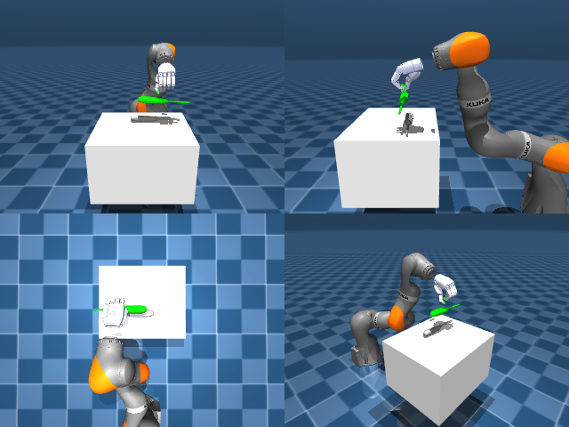

# Codex + GPT-6 Luna, reasoning effort xhigh, reasoning summaries on, 60 min — dextoolbench_screwdriver_long_screwdriver_spin_horizontal

Run: Harbor job `mj-gpt6luna-xhigh`, trial `dextoolbench_screwdriver_long_sc__ZHFkru5`, 2026-09-29. Mode: **unlimited**.

| | |
|---|---|
| result | **0** |
| agent time | 2908 s |
| actions / physics steps | 600 / — |
| tokens in / out | 6910690 / 94355 |
| verifier | `{"success": 0, "progress": 0.0, "goals_reached": 0, "n_goals": 31, "failed_on_timeout": 1, "deterministic": 1, "n_actions": 600, "control_steps_used": 600, "video_rendered": 1, "grader_error": 0, "agent_resets": 60, "agent_control_steps": 18930, "agent_cost_self_reported": 1, "agent_traces": 36, "agent_trace_videos": 6}` |
| verifier sandbox | separate |

Debugging footprint (self-reported by the agent's tooling log): 56 sessions, 60 resets, None physics steps.

## Replay (verifier's six-camera video)

[replay.mp4](replay.mp4) — top: world / observer / head; bottom: front / left wrist / right wrist.

## Agent's last messages

- The recorded run reached the 600 step timeout without lifting the screwdriver; the replay’s best goal distance remained far outside tolerance. I’m preserving the reproducible `gen.py` and trajectory, removing the exploratory probes, and checking the final archive layout.
- I found a more promising geometry to check before settling: a stronger wrist rotation could place the thumb and fingers on opposite sides of the handle. I’m testing whether that pose is reachable and whether its contacts stay balanced during a lift; I’ll replace the current artifact if it improves replay progress.
- Created [trajectory.npz](/app/output/trajectory.npz) with shape `(600, 29)` and its generator, [gen.py](/app/output/gen.py).  Replay reached **0 of 31 goals** and timed out on the first goal. The screwdriver slipped during the lift, so the trajectory does not earn reward.
