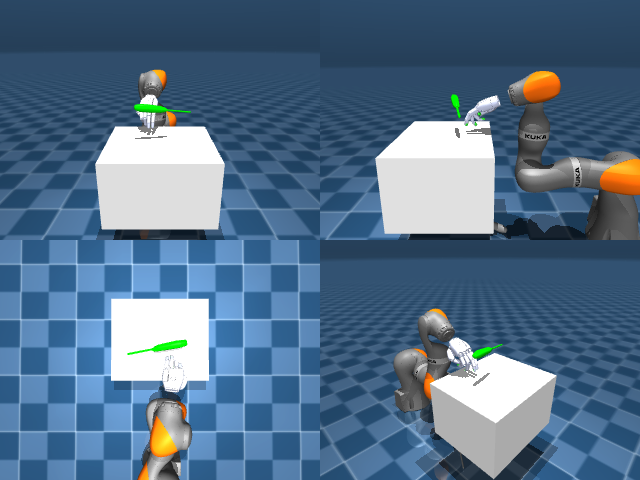

# Codex + GPT-6 Luna, reasoning effort xhigh, reasoning summaries on, 60 min, no per-goal time limit — dextoolbench_screwdriver_long_screwdriver_spin_vertical-limited

Run: Harbor job `dtbl-nt-gpt6luna-xhigh-rerun`, trial `dextoolbench_screwdriver_long_sc__UsQuxmw`, 2026-09-29. Mode: **limited (robot as a service)**.

| | |
|---|---|
| result | **0** |
| agent time | 3602 s |
| actions / physics steps | — / — |
| tokens in / out | 18244006 / 119732 |
| verifier | `{"success": 0, "deterministic": 1, "finalized": 1, "control_steps": 4236, "calls": 235, "elapsed_s": 3832.7, "video_rendered": 1, "grader_error": 0, "progress": 0.0, "goals_reached": 0, "n_goals": 100, "failed_on_timeout": 0}` |
| verifier sandbox | separate |

## Replay (verifier's six-camera video)

[replay.mp4](replay.mp4) — top: world / observer / head; bottom: front / left wrist / right wrist.

## Agent's last messages

- The screwdriver still rests on the table after lifting, so the current pinch is not secure. I’m resetting the hand posture while it’s clear of the tool, then I’ll make a fresh open-hand approach and close around the handle at contact height.
- The fresh open-hand approach let the fingers curl without being blocked by the tabletop. I’ve also measured a local arm response in the side camera; I’m using that to raise the hand straight up while preserving the pinch, instead of rotating the wrist and sliding off the handle.
- The arm lift itself is working, but the screwdriver stays on the table. The hand reaches the handle; the full fist seems to press it down rather than trap it, so I’m switching to a thumb–index pinch with the other fingers relaxed, then I’ll test another lift.
