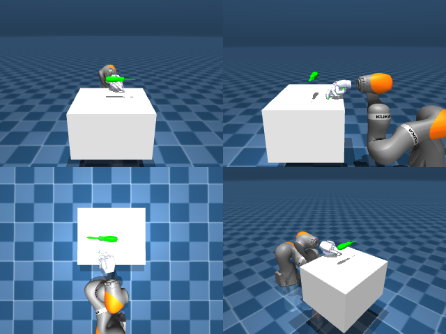

# Codex + GPT-6 Luna, reasoning effort xhigh, reasoning summaries on, 60 min, no per-goal time limit — dextoolbench_screwdriver_short_screwdriver_spin_horizontal-limited

Run: Harbor job `dtbl-nt-gpt6luna-xhigh`, trial `dextoolbench_screwdriver_short_s__CNwoayi`, 2026-09-29. Mode: **limited (robot as a service)**.

| | |
|---|---|
| result | **0** |
| agent time | 3365 s |
| actions / physics steps | — / — |
| tokens in / out | 24070037 / 138929 |
| verifier | `{"success": 0, "deterministic": 1, "finalized": 1, "control_steps": 8304, "calls": 275, "elapsed_s": 3560.0, "video_rendered": 1, "grader_error": 0, "progress": 0.0, "goals_reached": 0, "n_goals": 38, "failed_on_timeout": 0}` |
| verifier sandbox | separate |

## Replay (verifier's six-camera video)

[replay.mp4](replay.mp4) — top: world / observer / head; bottom: front / left wrist / right wrist.

## Agent's last messages

- The fingertip image alignment is close, but the handle still does not rise. I’m checking fingertip and tool depth in the same calibrated views now; that will tell me whether the remaining gap is height or table-plane alignment before the last grasp attempt.
- The oblique view shows the hand still offset from the real screwdriver. I’m making one last coordinated arm correction along the table plane while lowering the open fingers, then I’ll close and check the task state.
- The episode ended with **0/38 goals reached** after 8,304 control steps. I couldn’t secure the screwdriver; it remained on the table during the lift attempts.  I saved the RGB-D visual-servo controller at [gen.py](/app/output/gen.py:1).
