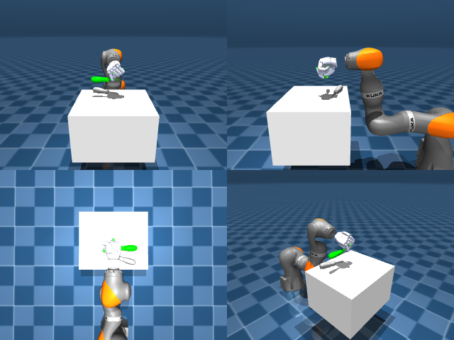

# Codex + GPT-6 Luna, reasoning effort xhigh, reasoning summaries on, 60 min, no per-goal time limit — dextoolbench_screwdriver_short_screwdriver_spin_vertical-limited

Run: Harbor job `dtbl-nt-gpt6luna-xhigh`, trial `dextoolbench_screwdriver_short_s__k2XVQfr`, 2026-09-29. Mode: **limited (robot as a service)**.

| | |
|---|---|
| result | **0** |
| agent time | 3464 s |
| actions / physics steps | — / — |
| tokens in / out | 18799388 / 137793 |
| verifier | `{"success": 0, "deterministic": 1, "finalized": 1, "control_steps": 9948, "calls": 334, "elapsed_s": 3628.4, "video_rendered": 1, "grader_error": 0, "progress": 0.0, "goals_reached": 0, "n_goals": 76, "failed_on_timeout": 0}` |
| verifier sandbox | separate |

## Replay (verifier's six-camera video)

[replay.mp4](replay.mp4) — top: world / observer / head; bottom: front / left wrist / right wrist.

## Agent's last messages

- The wrist roll change exposed the real fingertip location: the hand had been about 8–10 cm above the tool, despite overlapping it in the front image. With the rotated wrist, the fingers now point toward the handle. I’m lowering that fingertip point using a fresh camera-based joint estimate, then I’ll close and lift.
- The latest lift still left the screwdriver on the table, so no goal has registered. I’m saving the camera projection, hand-feature, finite-difference, and waypoint controller in `/app/output/gen.py` now, and I’ll leave the arm in its stable raised pose.
- I wasn’t able to grasp the screwdriver. The service still reports **0/76 goals reached** at goal 0, with about 1 second left; the screwdriver remained on the table in the last observations.  I saved the controller and approach logic at [gen.py](/app/output/gen.py).
