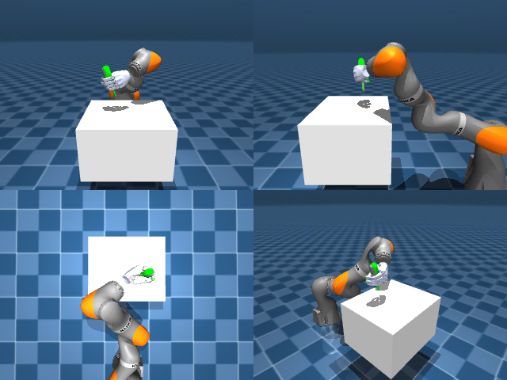

# Codex + GPT-6 Luna, reasoning effort xhigh, reasoning summaries on, 60 min — dextoolbench_screwdriver_short_screwdriver_spin_vertical

Run: Harbor job `mj-gpt6luna-xhigh`, trial `dextoolbench_screwdriver_short_s__g6fWZJP`, 2026-09-29. Mode: **unlimited**.

| | |
|---|---|
| result | **0** |
| agent time | 3602 s |
| actions / physics steps | 3038 / — |
| tokens in / out | 16148401 / 142864 |
| verifier | `{"success": 0, "progress": 0.1447, "goals_reached": 11, "n_goals": 76, "failed_on_timeout": 1, "deterministic": 1, "n_actions": 3038, "control_steps_used": 3038, "video_rendered": 1, "grader_error": 0, "agent_resets": 242, "agent_control_steps": 175090, "agent_cost_self_reported": 1, "agent_traces": 92, "agent_trace_videos": 3, "agent_trace_videos_skipped_budget": 1}` |
| verifier sandbox | separate |

Debugging footprint (self-reported by the agent's tooling log): 124 sessions, 242 resets, None physics steps.

## Replay (verifier's six-camera video)

[replay.mp4](replay.mp4) — top: world / observer / head; bottom: front / left wrist / right wrist.

## Agent's last messages

- I found the full-run mismatch: the grip ramp restarted at every goal change, briefly loosening the hand just as the tool entered goal 10. The branch test kept the tighter hand targets fixed and succeeded, so I’m making the grip ramp one-time and persistent after goal 4.
- The persistent-grip version now reaches 11/76. Goal 11 is within 8 mm in position but still about 12° off in orientation, and six contacts remain. I’m applying the upright spin torque setting to the later goals as well.
- The stronger wrist setting hurt goal 11, which is a vertical-axis spin rather than the earlier tilt. The baseline reaches closer there, so I’m switching that segment back and calibrating small wrist-spin corrections against the held tool.
