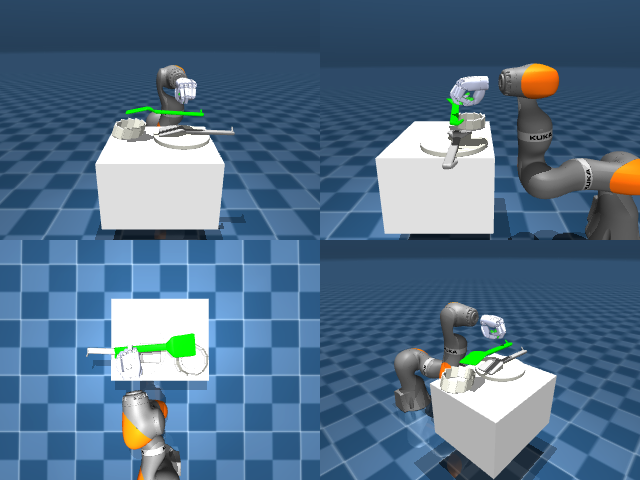

# Codex + GPT-6 Luna, reasoning effort xhigh, reasoning summaries on, 60 min — dextoolbench_spatula_flat_spatula_flip_over-limited

Run: Harbor job `mjl-gpt6luna-xhigh`, trial `dextoolbench_spatula_flat_spatul__Bqd7xei`, 2026-09-29. Mode: **limited (robot as a service)**.

| | |
|---|---|
| result | **0** |
| agent time | 997 s |
| actions / physics steps | — / — |
| tokens in / out | 2528797 / 46906 |
| verifier | `{"success": 0, "deterministic": 1, "finalized": 1, "control_steps": 600, "calls": 40, "elapsed_s": 955.6, "video_rendered": 1, "grader_error": 0, "progress": 0.0, "goals_reached": 0, "n_goals": 45, "failed_on_timeout": 1}` |
| verifier sandbox | separate |

## Replay (verifier's six-camera video)

[replay.mp4](replay.mp4) — top: world / observer / head; bottom: front / left wrist / right wrist.

## Agent's last messages

- The handle still does not rise with the hand, and the arm stalls against the table at this approach angle. I’m using the remaining first-goal steps to end the one live attempt cleanly, then I’ll save the controller and action history at the requested path.
- The episode ended on first-goal timeout with 0 of 45 goals reached. I’m saving the self-written joint controller sequence and its RGB/proprio observation helpers to `/app/output/gen.py` so the attempted policy is preserved.
- The episode ended on a timeout at goal 0: **0 of 45 goals reached**. The spatula did not lift with the hand, so I couldn’t proceed to the demonstrated poses. The service recorded the attempt and does not allow a reset.  I saved the replayable action sequence at [gen.py](/app/output/gen.py).
