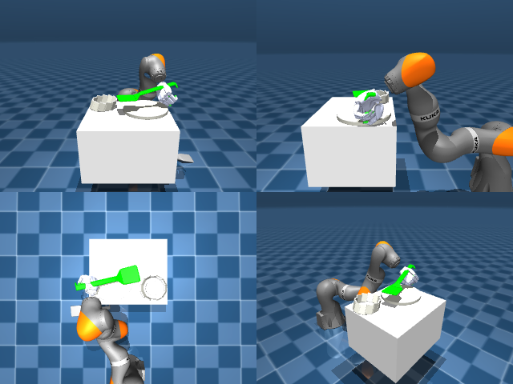

# Codex + GPT-6 Luna, reasoning effort xhigh, reasoning summaries on, 60 min, no per-goal time limit — dextoolbench_spatula_flat_spatula_serve_plate-limited

Run: Harbor job `dtbl-nt-gpt6luna-xhigh`, trial `dextoolbench_spatula_flat_spatul__9PVzkCD`, 2026-09-29. Mode: **limited (robot as a service)**.

| | |
|---|---|
| result | **0** |
| agent time | 3554 s |
| actions / physics steps | — / — |
| tokens in / out | 33802962 / 150626 |
| verifier | `{"success": 0, "deterministic": 1, "finalized": 1, "control_steps": 8958, "calls": 200, "elapsed_s": 3633.0, "video_rendered": 1, "grader_error": 0, "progress": 0.0, "goals_reached": 0, "n_goals": 33, "failed_on_timeout": 0}` |
| verifier sandbox | separate |

## Replay (verifier's six-camera video)

[replay.mp4](replay.mp4) — top: world / observer / head; bottom: front / left wrist / right wrist.

## Agent's last messages

- I’ve confirmed the tool still has not reached goal 0. The last approach improved the hand position at the plate edge, but the shaft remained on the plate during the lift checks. I’m saving the vision and joint-feedback controller to `/app/output/gen.py` now, along with the episode’s current status.
- There are about 113 seconds left in the service budget and the public task status is still 0/33. I’m using the saved controller for one bounded final vision-guided attempt, with its loop capped to the remaining service time.
- The spatula was not secured, and the episode did not reach any goals. At the last poll, the service reported **0/33 goals**, 8,958 control steps, and `done: false`; the episode trajectory is recorded by the service.  I saved the controller at [gen.py](/app/output/gen.py) and the last public status at [episode_status.json](/app/output/episode_status.json).
