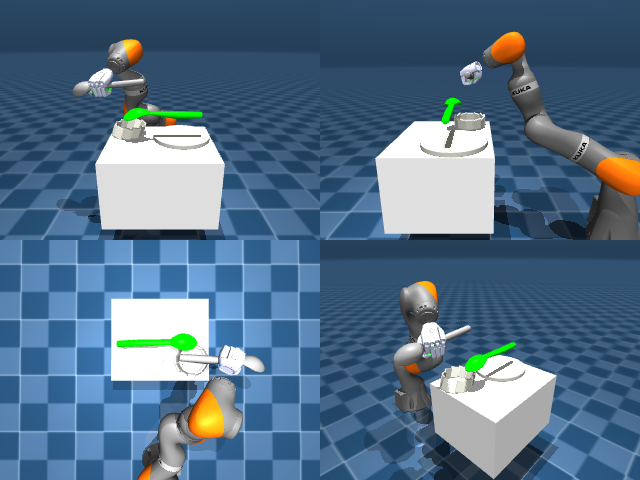

# Codex + GPT-6 Luna, reasoning effort xhigh, reasoning summaries on, 60 min, no per-goal time limit — dextoolbench_spatula_spoon_spatula_flip_over-limited

Run: Harbor job `dtbl-nt-gpt6luna-xhigh`, trial `dextoolbench_spatula_spoon_spatu__MyrnrfB`, 2026-09-29. Mode: **limited (robot as a service)**.

| | |
|---|---|
| result | **0** |
| agent time | 3560 s |
| actions / physics steps | — / — |
| tokens in / out | 19850823 / 165947 |
| verifier | `{"success": 0, "deterministic": 1, "finalized": 1, "control_steps": 7257, "calls": 199, "elapsed_s": 3640.9, "video_rendered": 1, "grader_error": 0, "progress": 0.0, "goals_reached": 0, "n_goals": 40, "failed_on_timeout": 0}` |
| verifier sandbox | separate |

## Replay (verifier's six-camera video)

[replay.mp4](replay.mp4) — top: world / observer / head; bottom: front / left wrist / right wrist.

## Agent's last messages

- The small-motion calibration is stable enough to start moving the held tool. I’m bringing it toward the goal in short increments, checking the top and oblique views between moves so I can correct the direction and height before attempting the flip motion.
- The tool is still following the hand. My last correction shifted it too far upward in the world, so I’m reversing that vertical and depth motion while reducing the remaining visible angle error.
- The service budget expired with 7,257 control steps and **0/40 goals reached**. The utensil appeared to move with the hand, but I couldn’t bring it to the first goal before time ran out.  The controller script is saved at [gen.py](/app/output/gen.py).
