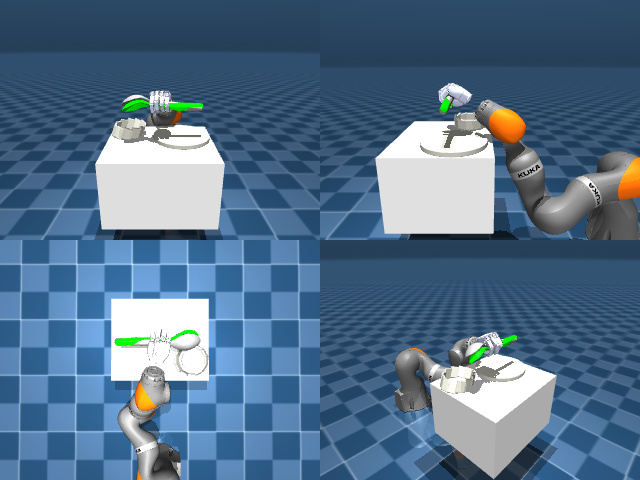

# Codex + GPT-6 Luna, reasoning effort xhigh, reasoning summaries on, 60 min — dextoolbench_spatula_spoon_spatula_flip_over

Run: Harbor job `mj-gpt6luna-xhigh`, trial `dextoolbench_spatula_spoon_spatu__kCkPzWd`, 2026-09-29. Mode: **unlimited**.

| | |
|---|---|
| result | **0** |
| agent time | 3231 s |
| actions / physics steps | 609 / — |
| tokens in / out | 9288920 / 118217 |
| verifier | `{"success": 0, "progress": 0.15, "goals_reached": 6, "n_goals": 40, "failed_on_timeout": 0, "deterministic": 1, "n_actions": 609, "control_steps_used": 609, "video_rendered": 1, "grader_error": 0, "agent_resets": 97, "agent_control_steps": 28788, "agent_cost_self_reported": 1, "agent_traces": 56, "agent_trace_videos": 6}` |
| verifier sandbox | separate |

Debugging footprint (self-reported by the agent's tooling log): 58 sessions, 97 resets, None physics steps.

## Replay (verifier's six-camera video)

[replay.mp4](replay.mp4) — top: world / observer / head; bottom: front / left wrist / right wrist.

## Agent's last messages

- The hand can lift the spoon, and the best trial carried it through five ordered goals. The remaining failure is arm tracking: my Cartesian updates drift into a poor joint posture. I’m switching to bounded pose IK with warm starts for each goal and keeping the grasp closed.
- The best controlled run reaches six of the 40 goals before the next large turn causes the tool to slip. I’m saving the verified six-goal prefix as the partial-credit trajectory and keeping its generator reproducible from the frozen start.
- Created [trajectory.npz](/app/output/trajectory.npz) and its generator, [gen.py](/app/output/gen.py).  Replay reached **6 of 40 goals** (reward **0.15**) in 609 control steps. The trajectory ends at that prefix without timing out; full success was not achieved.
