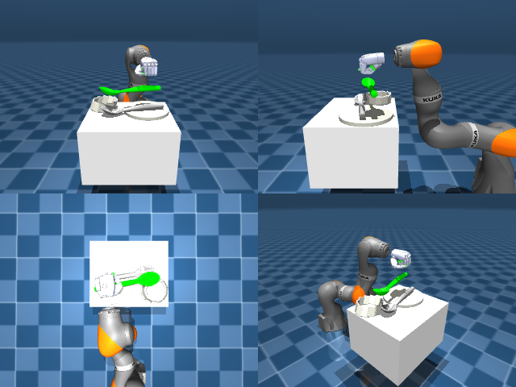

# Codex + GPT-6 Luna, reasoning effort xhigh, reasoning summaries on, 60 min — dextoolbench_spatula_spoon_spatula_serve_plate-limited

Run: Harbor job `mjl-gpt6luna-xhigh`, trial `dextoolbench_spatula_spoon_spatu__99ek65d`, 2026-09-29. Mode: **limited (robot as a service)**.

| | |
|---|---|
| result | **0** |
| agent time | 1030 s |
| actions / physics steps | — / — |
| tokens in / out | 2597826 / 51844 |
| verifier | `{"success": 0, "deterministic": 1, "finalized": 1, "control_steps": 600, "calls": 41, "elapsed_s": 1078.1, "video_rendered": 1, "grader_error": 0, "progress": 0.0, "goals_reached": 0, "n_goals": 48, "failed_on_timeout": 1}` |
| verifier sandbox | separate |

## Replay (verifier's six-camera video)

[replay.mp4](replay.mp4) — top: world / observer / head; bottom: front / left wrist / right wrist.

## Agent's last messages

- The hand is now centered over the handle, but the utensil stayed on the plate through the last lift, so that grasp did not hold. Goal 0 has 51 steps left. I’m using the remaining steps for one final lower-and-lift attempt from the corrected lateral position.
- The last cycle reached step 599 of 600 and still reports goal 0. I’m saving the control script now, then I’ll use the final control step and report the recorded result.
- The episode ended on goal 0’s timeout: **0 of 48 goals reached**. The hand approached and closed, but the utensil stayed on the plate through the lift attempts.  I saved the action sequence at [gen.py](/app/output/gen.py). The final observation and timeout status are in [meta.json](/app/output/last_step/meta.json).
