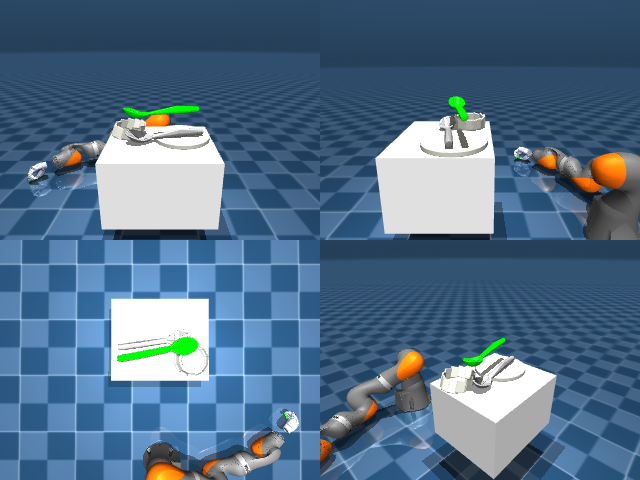

# Codex + GPT-6 Luna, reasoning effort xhigh, reasoning summaries on, 60 min — dextoolbench_spatula_spoon_spatula_serve_plate

Run: Harbor job `mj-gpt6luna-xhigh`, trial `dextoolbench_spatula_spoon_spatu__N2iYFXp`, 2026-09-29. Mode: **unlimited**.

| | |
|---|---|
| result | **0** |
| agent time | 3602 s |
| actions / physics steps | 600 / — |
| tokens in / out | 7886456 / 92119 |
| verifier | `{"success": 0, "progress": 0.0, "goals_reached": 0, "n_goals": 48, "failed_on_timeout": 1, "deterministic": 1, "n_actions": 600, "control_steps_used": 600, "video_rendered": 1, "grader_error": 0, "agent_resets": 46, "agent_control_steps": 9260, "agent_cost_self_reported": 1, "agent_traces": 20, "agent_trace_videos": 6}` |
| verifier sandbox | separate |

Debugging footprint (self-reported by the agent's tooling log): 42 sessions, 46 resets, None physics steps.

## Replay (verifier's six-camera video)

[replay.mp4](replay.mp4) — top: world / observer / head; bottom: front / left wrist / right wrist.

## Agent's last messages

- The side grasp is lifting the tool in simulation; during a trial lift it followed the hand from roughly 0.56 m to 0.66 m. I’m checking whether the controller can keep it stable while correcting the demonstrated poses. This first IK implementation is slower than expected, so I’m also watching its runtime before committing to all 48 poses.
- The initial grasp held only briefly because the tool rolled in the fingers. I’ve changed the grasp orientation so the hand spans the handle’s width, and the current trial is checking whether that keeps the tool steadier during a lift. This is the main tuning step; once the grasp is stable, the goal tracking itself is straightforward.
- I found a scene detail that changes the grasp plan: the tool settles on the plate during the first second, and the point I was targeting is a narrow neck rather than the handle. I’ve moved the grasp point onto the actual handle and am testing a widthwise pinch there.
