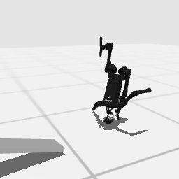

# Codex + GPT-6 Luna, effort medium — humanoidbench-loco-balance-hard-i00

Recorded 2026-09-28 before protocol v1.0 (Harbor job `hb-full-balance-hard-codex-gpt6luna-medium-60min-text7`, trial `humanoidbench-loco-balance-hard__i2ZsVa7`). Not an official v1.0 result: the run went through the repository's former OpenRouter adapter (`harbor_agents/`, removed under PROTOCOL D11), and on the task as it then was.

| | |
|---|---|
| result | **0** (return 47.96 / pass mark 800) |
| mode | privileged |
| task version | before protocol v1.0, which changed only this task's metadata and image name: the instruction it was given is today's, word for word, and the scene and verifier are the same. |
| agent | Codex 0.157.0 via OpenRouter, `openai/gpt-6-luna`, reasoning effort medium, web search off |
| budget | 60 min; tokens 100M in / 10M out (PROTOCOL D10) |
| agent time | 3552 s |
| tokens in / out | 23,083,122 / 164,475 (within the budget) |
| cost | $0.38 |
| verifier | `{"success": 0, "all_success": 0, "deterministic": 1, "n_actions": 101, "final_reward": 1.6315248030073026e-22, "sim_steps": 101, "grader_error": 0, "video_rendered": 1}` |

## What happened

CEM/MPC/target-schedule search on survival steps stuck at 88, then mutated recorded actions to 101; board flipped, replay 47.96
