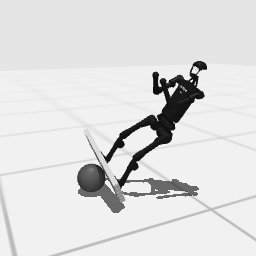

# Codex + GPT-6 Luna, effort medium — humanoidbench-loco-balance-simple-i00-standard

Recorded 2026-10-01 under protocol v1.0 (Harbor job `r50-hb-standard`, trial `humanoidbench-loco-balance-simpl__ar4u6es`).

| | |
|---|---|
| result | **0** |
| mode | standard (`eai-standard/2.1`); reset budget 50 (the optional reset capability, PROTOCOL D1: reported separately from runs without reset); sensors: head cameras, joint angles and velocities, pelvis IMU, room camera |
| agent | Harbor's `codex` agent, Codex 0.159.2, `openai/gpt-6-luna` through OpenRouter, reasoning effort medium, web search disabled (`scripts/humanoidbench/configs/codex-openrouter.yaml`) |
| budget | 60 min; tokens 100M in / 10M out (PROTOCOL D10) |
| agent time | 944 s |
| tokens in / out | 5,036,458 / 62,335 (within the budget) |
| cost | $0.09 |
| verifier | `{"success": 0, "live_success": 0, "replay_success": 0, "deterministic": 1, "finalized": 1, "missing_log": 0, "infra_error": 0, "grader_error": 0, "sim_crashed_on_call": 0, "n_actions": 95, "sim_steps": 3833, "calls": 730, "rows": 3705, "resets": 50, "reset_budget": 50, "sim_startups": 1, "elapsed_s": 904.7, "video_rendered": 1}` |

## What happened

First move within a minute of its first request; 671 chunks in all, 3833 control steps over 51 episodes (50 of its 50 resets used). Of the episodes before the last, 29 ended by the task's own termination, 21 abandoned by a reset while running. The graded episode 51 was ended by the task's own termination at its control step 95 (failed; this task ends when the robot falls, when anything but the fulcrum under the board touches the ground (see Scoring)).
