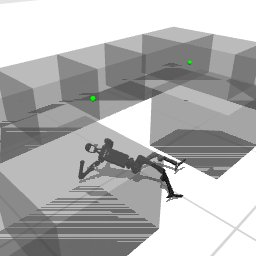

# Codex + GPT-6 Luna, effort medium — humanoidbench-loco-maze-i00

Recorded 2026-09-28 before protocol v1.0 (Harbor job `hb-full-maze-codex-gpt6luna-medium-60min-text7`, trial `humanoidbench-loco-maze-i00__W3xdUfJ`). Not an official v1.0 result: the run went through the repository's former OpenRouter adapter (`harbor_agents/`, removed under PROTOCOL D11), and on the task as it then was.

| | |
|---|---|
| result | **0** (return 393.08 / pass mark 1200) |
| mode | privileged |
| task version | before protocol v1.0, which changed only this task's metadata and image name: the instruction it was given is today's, word for word, and the scene and verifier are the same. |
| agent | Codex 0.157.0 via OpenRouter, `openai/gpt-6-luna`, reasoning effort medium, web search off |
| budget | 60 min; tokens 100M in / 10M out (PROTOCOL D10) |
| agent time | 3580 s |
| tokens in / out | 27,101,695 / 202,897 (within the budget) |
| cost | $0.45 |
| verifier | `{"success": 0, "all_success": 0, "deterministic": 1, "n_actions": 1000, "final_reward": 0.06666666768938881, "sim_steps": 1000, "grader_error": 0, "video_rendered": 1}` |

## What happened

action-block search found a forward dive onto the first corner (stage 2), then low knee/torso pulses crawled ~1 m; replay 393.08
