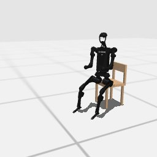

# Codex + GPT-6 Luna, effort medium — humanoidbench-loco-sit-hard-i00-standard

Recorded 2026-10-01 under protocol v1.0 (Harbor job `r50-hb-standard`, trial `humanoidbench-loco-sit-hard-i00__G53HRuW`).

| | |
|---|---|
| result | **1 (success)** |
| mode | standard (`eai-standard/2.1`); reset budget 50 (the optional reset capability, PROTOCOL D1: reported separately from runs without reset); sensors: head cameras, joint angles and velocities, pelvis IMU, room camera |
| agent | Harbor's `codex` agent, Codex 0.159.2, `openai/gpt-6-luna` through OpenRouter, reasoning effort medium, web search disabled (`scripts/humanoidbench/configs/codex-openrouter.yaml`) |
| budget | 60 min; tokens 100M in / 10M out (PROTOCOL D10) |
| agent time | 370 s |
| tokens in / out | 1,116,206 / 20,515 (within the budget) |
| cost | $0.03 |
| verifier | `{"success": 1, "live_success": 1, "replay_success": 1, "deterministic": 1, "finalized": 1, "missing_log": 0, "infra_error": 0, "grader_error": 0, "sim_crashed_on_call": 0, "n_actions": 940, "sim_steps": 1303, "calls": 33, "rows": 245, "resets": 4, "reset_budget": 50, "sim_startups": 1, "elapsed_s": 312.2, "video_rendered": 1}` |

`trajectory.npz` is the graded trajectory (the sidecar's record of the graded, last episode): a positive example for this task's human review (PROTOCOL §2.7).

## What happened

First move within a minute of its first request; 7 chunks in all, 1303 control steps over 5 episodes (4 of its 50 resets used). Of the episodes before the last, 2 ended by the task's own termination, 2 abandoned by a reset while running. Episode 5 reached the goal at its control step 940 (success); the fresh replay agreed.
