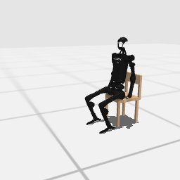

# Codex + GPT-6 Luna, effort medium — humanoidbench-loco-sit-simple-i00-standard

Recorded 2026-10-01 under protocol v1.0 (Harbor job `h-luna-sit-std`, trial `humanoidbench-loco-sit-simple-i0__qVTCZai`). Since then the instruction has had two small fixes (a code span joined; `"error"` added to the reasons an episode can end with); the task is otherwise unchanged.

| | |
|---|---|
| result | **1 (success)** |
| mode | standard (`eai-standard/2.1`); reset budget 0 (the standard configuration); sensors: head cameras, joint angles and velocities, pelvis IMU, room camera |
| agent | Harbor's `codex` agent, Codex 0.159.2, `openai/gpt-6-luna` through OpenRouter, reasoning effort medium, web search disabled (`scripts/humanoidbench/configs/codex-openrouter.yaml`) |
| budget | 60 min; tokens 100M in / 10M out (PROTOCOL D10) |
| agent time | 104 s |
| tokens in / out | 246,578 / 6,587 (within the budget) |
| cost | $0.01 |
| verifier | `{"success": 1, "live_success": 1, "replay_success": 1, "deterministic": 1, "finalized": 1, "missing_log": 0, "infra_error": 0, "grader_error": 0, "sim_crashed_on_call": 0, "n_actions": 826, "sim_steps": 826, "calls": 6, "rows": 826, "resets": 0, "sim_startups": 1, "elapsed_s": 72.1, "video_rendered": 1}` |

`trajectory.npz` is the graded trajectory (the sidecar's record of the episode): a positive example for this task's human review (PROTOCOL §2.7).

## What happened

Found the chair behind the robot in the room camera, lowered the robot into a seated posture over 2 s (100 rows, linear) and held it (200, then 500 rows); the return reached the pass mark at control step 826 of its only episode, which ended it there (success). Six calls, agent time 104 s.
