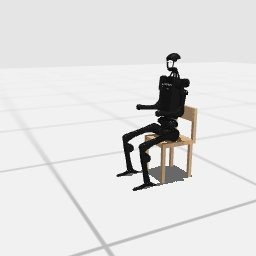

# Codex + GPT-6 Luna, effort medium — humanoidbench-loco-sit-simple-i00

Recorded 2026-09-28 before protocol v1.0 (Harbor job `hb-full-sit-simple-codex-gpt6luna-medium-60min-text7`, trial `humanoidbench-loco-sit-simple-i0__Q6Fp4FJ`). Not an official v1.0 result: the run went through the repository's former OpenRouter adapter (`harbor_agents/`, removed under PROTOCOL D11), and on the task as it then was.

| | |
|---|---|
| result | **1 (success)** (return 980.68 / pass mark 750) |
| mode | privileged |
| task version | before protocol v1.0, which changed only this task's metadata and image name: the instruction it was given is today's, word for word, and the scene and verifier are the same. |
| agent | Codex 0.157.0 via OpenRouter, `openai/gpt-6-luna`, reasoning effort medium, web search off |
| budget | 60 min; tokens 100M in / 10M out (PROTOCOL D10) |
| agent time | 3530 s |
| tokens in / out | 32,687,745 / 110,530 (within the budget) |
| cost | $0.41 |
| verifier | `{"success": 1, "all_success": 1, "deterministic": 1, "n_actions": 1000, "final_reward": 0.9896567789576114, "sim_steps": 1000, "grader_error": 0, "video_rendered": 1}` |

`trajectory.npz` is the graded trajectory (the agent's deliverable): the positive example this task's human review checks (PROTOCOL §2.7).

## What happened

own 6-term proxy; pose sweep (hip -1.2/knee 1.5/ankle -0.2), staggered joint ramps + shoulder/torso pulse, seated hold; replay 980.68
