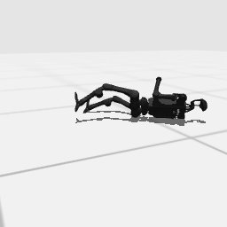

# Codex + GPT-6 Luna, effort medium — humanoidbench-loco-walk-i00-standard

Recorded 2026-10-01 under protocol v1.0 (Harbor job `h-luna-walk-std`, trial `humanoidbench-loco-walk-i00-stan__xs7nhYU`). Since then the instruction has had two small fixes (a code span joined; `"error"` added to the reasons an episode can end with); the task is otherwise unchanged.

| | |
|---|---|
| result | **0** |
| mode | standard (`eai-standard/2.1`); reset budget 0 (the standard configuration); sensors: head cameras, joint angles and velocities, pelvis IMU, room camera |
| agent | Harbor's `codex` agent, Codex 0.159.2, `openai/gpt-6-luna` through OpenRouter, reasoning effort medium, web search disabled (`scripts/humanoidbench/configs/codex-openrouter.yaml`) |
| budget | 60 min; tokens 100M in / 10M out (PROTOCOL D10) |
| agent time | 106 s |
| tokens in / out | 245,206 / 4,703 (within the budget) |
| cost | $0.01 |
| verifier | `{"success": 0, "live_success": 0, "replay_success": 0, "deterministic": 1, "finalized": 1, "missing_log": 0, "infra_error": 0, "grader_error": 0, "sim_crashed_on_call": 0, "n_actions": 80, "sim_steps": 80, "calls": 9, "rows": 80, "resets": 0, "sim_startups": 1, "elapsed_s": 70.4, "video_rendered": 1}` |

## What happened

Looked at the start (two free observations), held the start pose for 0.2 s (10 rows; the knees and ankles sagged about 0.15 rad), then sent an alternating leg swing in 0.5 s chunks; the robot fell in the third chunk, at control step 80, which ends the episode (failed). With no reset there was nothing left to run: agent time 106 s.
