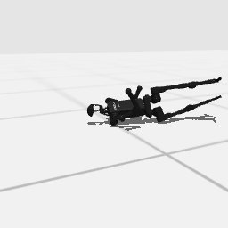

# Codex + GPT-6 Luna, effort medium — humanoidbench-loco-walk-i00

Recorded 2026-09-28 before protocol v1.0 (Harbor job `hb-full-walk-codex-gpt6luna-medium-60min-text7`, trial `humanoidbench-loco-walk-i00__2Ridff7`). Not an official v1.0 result: the run went through the repository's former OpenRouter adapter (`harbor_agents/`, removed under PROTOCOL D11), and on the task as it then was.

| | |
|---|---|
| result | **0** (return 128.52 / pass mark 700) |
| mode | privileged |
| task version | before protocol v1.0, which changed only this task's metadata and image name: the instruction it was given is today's, word for word, and the scene and verifier are the same. |
| agent | Codex 0.157.0 via OpenRouter, `openai/gpt-6-luna`, reasoning effort medium, web search off |
| budget | 60 min; tokens 100M in / 10M out (PROTOCOL D10) |
| agent time | 3603 s |
| tokens in / out | 25,249,094 / 193,314 (within the budget) |
| cost | $0.43 |
| verifier | `{"success": 0, "all_success": 0, "deterministic": 1, "n_actions": 491, "final_reward": 1.6517079942546666e-15, "sim_steps": 491, "grader_error": 0, "video_rendered": 1}` |

## What happened

phase gait + hip-roll feedback + timed offsets; proxy credited standing until 51 min; 491-step take falls ~step 360; 60-min timeout
