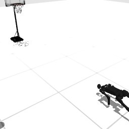

# Codex + GPT-6 Luna, effort medium — humanoidbench-manip-basketball-i00-standard

Recorded 2026-10-01 under protocol v1.0 (Harbor job `r50-hb-standard`, trial `humanoidbench-manip-basketball-i__wphwRAX`).

| | |
|---|---|
| result | **0** |
| mode | standard (`eai-standard/2.1`); reset budget 50 (the optional reset capability, PROTOCOL D1: reported separately from runs without reset); sensors: head cameras, joint angles and velocities, pelvis IMU, room camera |
| agent | Harbor's `codex` agent, Codex 0.159.2, `openai/gpt-6-luna` through OpenRouter, reasoning effort medium, web search disabled (`scripts/humanoidbench/configs/codex-openrouter.yaml`) |
| budget | 60 min; tokens 100M in / 10M out (PROTOCOL D10) |
| agent time | 3603 s |
| tokens in / out | 29,747,571 / 174,731 (within the budget) |
| cost | $0.41 |
| verifier | `{"success": 0, "live_success": 0, "replay_success": 0, "deterministic": 1, "finalized": 1, "missing_log": 0, "infra_error": 0, "grader_error": 0, "sim_crashed_on_call": 0, "n_actions": 51, "sim_steps": 1308, "calls": 331, "rows": 1308, "resets": 43, "reset_budget": 50, "sim_startups": 1, "elapsed_s": 3547.0, "video_rendered": 1}` |

## What happened

First move within a minute of its first request; 145 chunks in all, 1308 control steps over 44 episodes (43 of its 50 resets used); its own labels include "raise both arms for catch", "sweep pitch=-1.6 elbow=-0.3", "sweep pitch=-1.8 elbow=-0.3" (and 2 more). Of the episodes before the last, 6 ended by the task's own termination, 37 abandoned by a reset while running. The graded episode 44 was ended by the task's own termination at its control step 51 (failed; this task ends when the ball goes through the hoop, when the ball drops low, when the robot falls).
