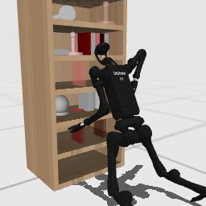

# Codex + GPT-6 Luna, effort medium — humanoidbench-manip-bookshelf-simple-i00-standard, 50 resets

Recorded 2026-09-28 before protocol v1.0 (Harbor job `hb-limited-bookshelf-simple-codex-gpt6luna-medium-60min-reset50-imu-roomcam-text7`, trial `humanoidbench-manip-bookshelf-si__MHqvLWZ`). Not an official v1.0 result: the run went through the repository's former OpenRouter adapter (`harbor_agents/`, removed under PROTOCOL D11), and on the task as it then was.

| | |
|---|---|
| result | **0** (return 641.18 / pass mark 2000) |
| mode | standard; reset budget 50 (resets used: 50); sensors: head+joints+imu+room |
| task version | rcb-limited/1.1, the protocol before v1.0: one action or a batch per `POST /step`, base64 images, `POST /reset` within a budget; this task now speaks eai-standard/2.1, so its instruction and client differ from what this run had. The scene, sensors, actions and success check are the same. |
| agent | Codex 0.157.0 via OpenRouter, `openai/gpt-6-luna`, reasoning effort medium, web search off |
| budget | 60 min; tokens 100M in / 10M out (PROTOCOL D10) |
| agent time | 2389 s |
| tokens in / out | 25,807,376 / 131,267 (within the budget) |
| cost | $0.35 |
| verifier | `{"success": 0, "live_success": 0, "replay_success": 0, "deterministic": 1, "finalized": 1, "n_actions": 1000, "sim_steps": 36848, "steps": 36848, "resets": 50, "elapsed_s": 2307.7, "video_rendered": 1, "grader_error": 0}` |

## What happened

IMU hip-feedback stance from ep11; camera-guided reaches never moved trophy; gen.py loop burned 29 resets in 2.3 min; ep50 stood 1000 steps
