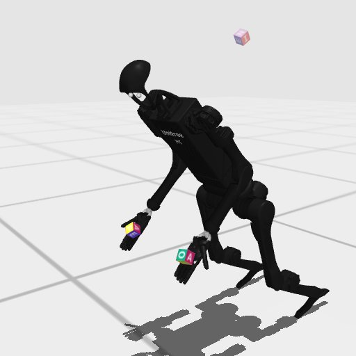

# Claude Code + Claude Opus 5.5, effort medium — humanoidbench-manip-cube-i00-standard, 50 resets

Recorded 2026-09-28 before protocol v1.0 (Harbor job `hb-limited-cube-claudecode-opus55-medium-60min-reset50-imu-roomcam-text7`, trial `humanoidbench-manip-cube-i00-lim__P9dfBad`). Not an official v1.0 result: the run went through the repository's former OpenRouter adapter (`harbor_agents/`, removed under PROTOCOL D11), and on the task as it then was.

| | |
|---|---|
| result | **0** (return 87.86 / pass mark 370) |
| mode | standard; reset budget 50 (resets used: 37); sensors: head+joints+imu+room |
| task version | rcb-limited/1.1, the protocol before v1.0: one action or a batch per `POST /step`, base64 images, `POST /reset` within a budget; this task now speaks eai-standard/2.1, so its instruction and client differ from what this run had. The scene, sensors, actions and success check are the same. |
| agent | Claude Code 2.1.283 via OpenRouter, `anthropic/claude-opus-5.5`, reasoning effort medium, web search off |
| budget | 60 min; tokens 100M in / 10M out (PROTOCOL D10) |
| agent time | 349 s |
| tokens in / out | 1,408,959 / 19,548 (within the budget) |
| cost | $0.88 |
| verifier | `{"success": 0, "live_success": 0, "replay_success": 0, "deterministic": 1, "finalized": 1, "n_actions": 182, "sim_steps": 3776, "steps": 3776, "resets": 37, "elapsed_s": 337.3, "video_rendered": 1, "grader_error": 0}` |

## What happened

IMU ankle-feedback grid sweeps, ankle angle as CoM proxy (links unused); best 182 steps; quit at 5.8 min with 13 resets left; graded ep37 87.86
