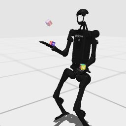

# Claude Code + Claude Opus 5.5, effort medium — humanoidbench-manip-cube-i00

Recorded 2026-09-28 before protocol v1.0 (Harbor job `hb-full-cube-claudecode-opus55-medium-60min-text7`, trial `humanoidbench-manip-cube-i00__o94E5nq`). Not an official v1.0 result: the run went through the repository's former OpenRouter adapter (`harbor_agents/`, removed under PROTOCOL D11), and on the task as it then was.

| | |
|---|---|
| result | **0** (return 247.48 / pass mark 370) |
| mode | privileged |
| task version | before protocol v1.0, which changed only this task's metadata and image name: the instruction it was given is today's, word for word, and the scene and verifier are the same. |
| agent | Claude Code 2.1.283 via OpenRouter, `anthropic/claude-opus-5.5`, reasoning effort medium, web search off |
| budget | 60 min; tokens 100M in / 10M out (PROTOCOL D10) |
| agent time | 1040 s |
| tokens in / out | 1,518,178 / 22,802 (within the budget) |
| cost | $0.96 |
| verifier | `{"success": 0, "all_success": 0, "deterministic": 1, "n_actions": 500, "final_reward": 0.4941619212344208, "sim_steps": 500, "grader_error": 0, "video_rendered": 1}` |

## What happened

subtree_com ankle feedback stands 500 steps in 3 min; CEM on arm/hand knots never turned the cubes; stopped at 17.3 min believing time short; 247.48
