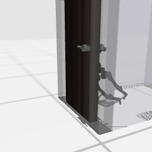

# Codex + GPT-6 Luna, effort medium — humanoidbench-manip-door-i00-standard

Recorded 2026-10-01 under protocol v1.0 (Harbor job `r50-hb-standard`, trial `humanoidbench-manip-door-i00-sta__LBLvrBw`).

| | |
|---|---|
| result | **0** |
| mode | standard (`eai-standard/2.1`); reset budget 50 (the optional reset capability, PROTOCOL D1: reported separately from runs without reset); sensors: head cameras, joint angles and velocities, pelvis IMU, room camera |
| agent | Harbor's `codex` agent, Codex 0.159.2, `openai/gpt-6-luna` through OpenRouter, reasoning effort medium, web search disabled (`scripts/humanoidbench/configs/codex-openrouter.yaml`) |
| budget | 60 min; tokens 100M in / 10M out (PROTOCOL D10) |
| agent time | 3603 s |
| tokens in / out | 29,953,938 / 171,156 (within the budget) |
| cost | $0.45 |
| verifier | `{"success": 0, "live_success": 0, "replay_success": 0, "deterministic": 1, "finalized": 1, "missing_log": 0, "infra_error": 0, "grader_error": 0, "sim_crashed_on_call": 0, "n_actions": 405, "sim_steps": 6867, "calls": 691, "rows": 6748, "resets": 36, "reset_budget": 50, "sim_startups": 1, "elapsed_s": 3591.8, "video_rendered": 1}` |

## What happened

First move within a minute of its first request; 339 chunks in all, 6867 control steps over 37 episodes (36 of its 50 resets used); its own labels include "reach toward door handle", "extend right arm toward handle", "pull right hand back from handle" (and 102 more). Of the episodes before the last, 24 ended by the task's own termination, 12 abandoned by a reset while running. The graded episode 37 was still running at its control step 405 when its 60 min ran out (timeout).
