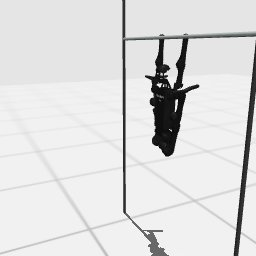

# Codex + GPT-6 Luna, effort medium — humanoidbench-manip-highbar-simple-i00-standard

Recorded 2026-10-01 under protocol v1.0 (Harbor job `n0-hb-standard`, trial `humanoidbench-manip-highbar-simp__Zb6ECZm`).

| | |
|---|---|
| result | **0** |
| mode | standard (`eai-standard/2.1`); reset budget 0 (the standard configuration); sensors: head cameras, joint angles and velocities, pelvis IMU, room camera |
| agent | Harbor's `codex` agent, Codex 0.159.2, `openai/gpt-6-luna` through OpenRouter, reasoning effort medium, web search disabled (`scripts/humanoidbench/configs/codex-openrouter.yaml`) |
| budget | 60 min; tokens 100M in / 10M out (PROTOCOL D10) |
| agent time | 744 s |
| tokens in / out | 3,803,956 / 49,075 (within the budget) |
| cost | $0.07 |
| verifier | `{"success": 0, "live_success": 0, "replay_success": 0, "deterministic": 1, "finalized": 1, "missing_log": 0, "infra_error": 0, "grader_error": 0, "sim_crashed_on_call": 0, "n_actions": 1000, "sim_steps": 1000, "calls": 96, "rows": 1000, "resets": 0, "reset_budget": 0, "sim_startups": 1, "elapsed_s": 724.6, "video_rendered": 1}` |

## What happened

First move within a minute of its first request (after 3 free looks), then 46 chunks of 1–40 rows (hold, dt 0.02 s; linear, dt 0.02 s); its own labels: "initial leg tuck and extension swing probe", "leg extension pulse", "large symmetric tuck" (and 43 more). The episode used up its 1000 control steps without reaching the goal (failed).
