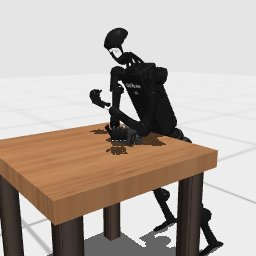

# Codex + GPT-6 Luna, effort medium — humanoidbench-manip-insert-normal-i00

Recorded 2026-09-28 before protocol v1.0 (Harbor job `hb-full-insert-normal-codex-gpt6luna-medium-60min-text7`, trial `humanoidbench-manip-insert-norma__jbF6oAh`). Not an official v1.0 result: the run went through the repository's former OpenRouter adapter (`harbor_agents/`, removed under PROTOCOL D11), and on the task as it then was.

| | |
|---|---|
| result | **0** (return 194.91 / pass mark 350) |
| mode | privileged |
| task version | before protocol v1.0, which changed only this task's metadata and image name: the instruction it was given is today's, word for word, and the scene and verifier are the same. |
| agent | Codex 0.157.0 via OpenRouter, `openai/gpt-6-luna`, reasoning effort medium, web search off |
| budget | 60 min; tokens 100M in / 10M out (PROTOCOL D10) |
| agent time | 3602 s |
| tokens in / out | 28,351,861 / 231,870 (within the budget) |
| cost | $0.48 |
| verifier | `{"success": 0, "all_success": 0, "deterministic": 1, "n_actions": 500, "final_reward": 0.583878541484403, "sim_steps": 500, "grader_error": 0, "video_rendered": 1}` |

## What happened

push + ~30 deg asymmetric turn, slow cross-arm pose and leg extension; ends 0.10/0.14 m from matching sockets, not lifted; timed out
