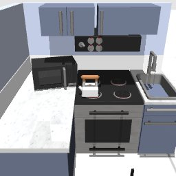

# Codex + GPT-6 Luna, effort medium — humanoidbench-manip-kitchen-i00-standard

Recorded 2026-10-01 under protocol v1.0 (Harbor job `r50-hb-standard`, trial `humanoidbench-manip-kitchen-i00__YY7CNwg`).

| | |
|---|---|
| result | **0** |
| mode | standard (`eai-standard/2.1`); reset budget 50 (the optional reset capability, PROTOCOL D1: reported separately from runs without reset); sensors: head cameras, joint angles and velocities, pelvis IMU, room camera |
| agent | Harbor's `codex` agent, Codex 0.159.2, `openai/gpt-6-luna` through OpenRouter, reasoning effort medium, web search disabled (`scripts/humanoidbench/configs/codex-openrouter.yaml`) |
| budget | 60 min; tokens 100M in / 10M out (PROTOCOL D10) |
| agent time | 3603 s |
| tokens in / out | 30,733,806 / 169,356 (within the budget) |
| cost | $0.42 |
| verifier | `{"success": 0, "live_success": 0, "replay_success": 0, "deterministic": 1, "finalized": 1, "missing_log": 0, "infra_error": 0, "grader_error": 0, "sim_crashed_on_call": 0, "n_actions": 500, "sim_steps": 4598, "calls": 815, "rows": 4548, "resets": 35, "reset_budget": 50, "sim_startups": 1, "elapsed_s": 3587.4, "video_rendered": 1}` |

## What happened

First move 1 min after its first request; 700 chunks in all, 4598 control steps over 36 episodes (35 of its 50 resets used); its own labels include "left arm reach toward microwave", "raise and align left hand to microwave handle", "hold startup stance" (and 207 more). Of the episodes before the last, 4 used all 500 steps, 31 abandoned by a reset while running. The graded episode 36 used up its 500 control steps without reaching the goal (failed).
