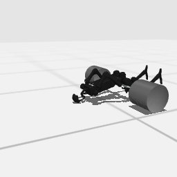

# Codex + GPT-6 Luna, effort medium — humanoidbench-manip-powerlift-i00-standard

Recorded 2026-10-01 under protocol v1.0 (Harbor job `r50-hb-standard`, trial `humanoidbench-manip-powerlift-i0__q3txoMZ`).

| | |
|---|---|
| result | **0** |
| mode | standard (`eai-standard/2.1`); reset budget 50 (the optional reset capability, PROTOCOL D1: reported separately from runs without reset); sensors: head cameras, joint angles and velocities, pelvis IMU, room camera |
| agent | Harbor's `codex` agent, Codex 0.159.2, `openai/gpt-6-luna` through OpenRouter, reasoning effort medium, web search disabled (`scripts/humanoidbench/configs/codex-openrouter.yaml`) |
| budget | 60 min; tokens 100M in / 10M out (PROTOCOL D10) |
| agent time | 3420 s |
| tokens in / out | 22,397,828 / 201,575 (within the budget) |
| cost | $0.38 |
| verifier | `{"success": 0, "live_success": 0, "replay_success": 0, "deterministic": 1, "finalized": 1, "missing_log": 0, "infra_error": 0, "grader_error": 0, "sim_crashed_on_call": 0, "n_actions": 1000, "sim_steps": 5400, "calls": 313, "rows": 4550, "resets": 50, "reset_budget": 50, "sim_startups": 1, "elapsed_s": 3371.6, "video_rendered": 1}` |

## What happened

First move 1 min after its first request; 197 chunks in all, 5400 control steps over 51 episodes (50 of its 50 resets used); its own labels include "reach_1", "reach_2", "grip_pull" (and 27 more). Of the episodes before the last, 8 ended by the task's own termination, 42 abandoned by a reset while running. The graded episode 51 used up its 1000 control steps without reaching the goal (failed).
