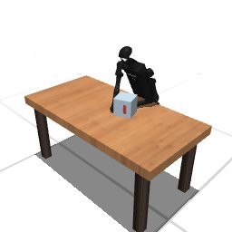

# Claude Code + Claude Opus 5.5, effort medium — humanoidbench-manip-push-i00-standard, 50 resets

Recorded 2026-09-28 before protocol v1.0 (Harbor job `hb-limited-push-claudecode-opus55-medium-60min-reset50-imu-roomcam-text7`, trial `humanoidbench-manip-push-i00-lim__cDCtYy5`). Not an official v1.0 result: the run went through the repository's former OpenRouter adapter (`harbor_agents/`, removed under PROTOCOL D11), and on the task as it then was.

| | |
|---|---|
| result | **1 (success)** (return 913.15 / pass mark 700) |
| mode | standard; reset budget 50 (resets used: 9); sensors: head+joints+imu+room |
| task version | rcb-limited/1.1, the protocol before v1.0: one action or a batch per `POST /step`, base64 images, `POST /reset` within a budget; this task now speaks eai-standard/2.1, so its instruction and client differ from what this run had. The scene, sensors, actions and success check are the same. |
| agent | Claude Code 2.1.283 via OpenRouter, `anthropic/claude-opus-5.5`, reasoning effort medium, web search off |
| budget | 60 min; tokens 100M in / 10M out (PROTOCOL D10) |
| agent time | 754 s |
| tokens in / out | 5,127,709 / 43,133 (within the budget) |
| cost | $2.26 |
| verifier | `{"success": 1, "live_success": 1, "replay_success": 1, "deterministic": 1, "finalized": 1, "n_actions": 403, "sim_steps": 2534, "steps": 2534, "resets": 9, "elapsed_s": 704.1, "video_rendered": 1, "grader_error": 0}` |

`trajectory.npz` is the graded trajectory (the sidecar's record of the graded episode): the positive example this task's human review checks (PROTOCOL §2.7).

## What happened

IMU ankle feedback leans on table; spec FK/IK + room-cam pixel pushes, right sweep then left hand; success step 403 (913.15), 9 resets
