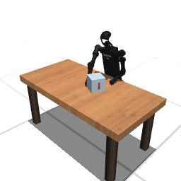

# Codex + GPT-6 Luna, effort medium — humanoidbench-manip-push-i00-standard

Recorded 2026-10-01 under protocol v1.0 (Harbor job `r50-hb-standard`, trial `humanoidbench-manip-push-i00-sta__eM74L5Y`).

| | |
|---|---|
| result | **1 (success)** |
| mode | standard (`eai-standard/2.1`); reset budget 50 (the optional reset capability, PROTOCOL D1: reported separately from runs without reset); sensors: head cameras, joint angles and velocities, pelvis IMU, room camera |
| agent | Harbor's `codex` agent, Codex 0.159.2, `openai/gpt-6-luna` through OpenRouter, reasoning effort medium, web search disabled (`scripts/humanoidbench/configs/codex-openrouter.yaml`) |
| budget | 60 min; tokens 100M in / 10M out (PROTOCOL D10) |
| agent time | 1428 s |
| tokens in / out | 8,106,659 / 55,257 (within the budget) |
| cost | $0.12 |
| verifier | `{"success": 1, "live_success": 1, "replay_success": 1, "deterministic": 1, "finalized": 1, "missing_log": 0, "infra_error": 0, "grader_error": 0, "sim_crashed_on_call": 0, "n_actions": 100, "sim_steps": 1900, "calls": 83, "rows": 1900, "resets": 10, "reset_budget": 50, "sim_startups": 1, "elapsed_s": 1330.6, "video_rendered": 1}` |

`trajectory.npz` is the graded trajectory (the sidecar's record of the graded, last episode): a positive example for this task's human review (PROTOCOL §2.7).

## What happened

First move 1 min after its first request; 35 chunks in all, 1900 control steps over 11 episodes (10 of its 50 resets used); its own labels include "reach_left", "reach_right", "hold" (and 3 more). Of the episodes before the last, 1 used all 500 steps, 9 abandoned by a reset while running. Episode 11 reached the goal at its control step 100 (success); the fresh replay agreed.
