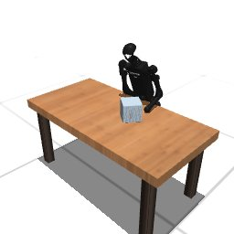

# Codex + GPT-6 Sol, effort medium — humanoidbench-manip-push-i00-standard, 50 resets

Recorded 2026-09-28 before protocol v1.0 (Harbor job `hb-limited-push-codex-gpt6sol-medium-60min-reset50-imu-roomcam-text7`, trial `humanoidbench-manip-push-i00-lim__T5obT3r`). Not an official v1.0 result: the run went through the repository's former OpenRouter adapter (`harbor_agents/`, removed under PROTOCOL D11), and on the task as it then was.

| | |
|---|---|
| result | **1 (success)** (return 969.31 / pass mark 700) |
| mode | standard; reset budget 50 (resets used: 7); sensors: head+joints+imu+room |
| task version | rcb-limited/1.1, the protocol before v1.0: one action or a batch per `POST /step`, base64 images, `POST /reset` within a budget; this task now speaks eai-standard/2.1, so its instruction and client differ from what this run had. The scene, sensors, actions and success check are the same. |
| agent | Codex 0.157.0 via OpenRouter, `openai/gpt-6-sol`, reasoning effort medium, web search off |
| budget | 60 min; tokens 100M in / 10M out (PROTOCOL D10) |
| agent time | 1095 s |
| tokens in / out | 4,785,946 / 25,663 (within the budget) |
| cost | $1.41 |
| verifier | `{"success": 1, "live_success": 1, "replay_success": 1, "deterministic": 1, "finalized": 1, "n_actions": 110, "sim_steps": 1545, "steps": 1545, "resets": 7, "elapsed_s": 1028.3, "video_rendered": 1, "grader_error": 0}` |

`trajectory.npz` is the graded trajectory (the sidecar's record of the graded episode): the positive example this task's human review checks (PROTOCOL §2.7).

## What happened

ankle -0.65 lean to table edge + right shoulder-yaw sweep; 8-variant sweep search, 2nd succeeded at step 110 (969.31); 7 resets
