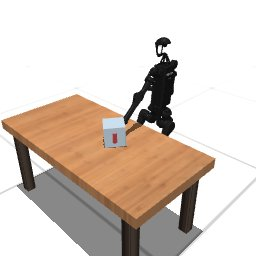

# Claude Code + Claude Opus 5.5, effort medium — humanoidbench-manip-push-i00

Recorded 2026-09-28 before protocol v1.0 (Harbor job `hb-full-push-claudecode-opus55-medium-60min-text7`, trial `humanoidbench-manip-push-i00__LWer47V`). Not an official v1.0 result: the run went through the repository's former OpenRouter adapter (`harbor_agents/`, removed under PROTOCOL D11), and on the task as it then was.

| | |
|---|---|
| result | **1 (success)** (return 966.99 / pass mark 700) |
| mode | privileged |
| task version | before protocol v1.0, which changed only this task's metadata and image name: the instruction it was given is today's, word for word, and the scene and verifier are the same. |
| agent | Claude Code 2.1.283 via OpenRouter, `anthropic/claude-opus-5.5`, reasoning effort medium, web search off |
| budget | 60 min; tokens 100M in / 10M out (PROTOCOL D10) |
| agent time | 231 s |
| tokens in / out | 863,140 / 14,487 (within the budget) |
| cost | $0.63 |
| verifier | `{"success": 1, "all_success": 1, "deterministic": 1, "n_actions": 142, "final_reward": 999.9360966456003, "sim_steps": 142, "grader_error": 0, "video_rendered": 1}` |

`trajectory.npz` is the graded trajectory (the agent's deliverable): the positive example this task's human review checks (PROTOCOL §2.7).

## What happened

CoM/pitch balance feedback (CEM gains) + left-hand IK push from behind box; success at step 141, 142 actions, 966.99; quit at 3.9 min
