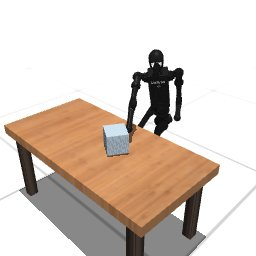

# Codex + GPT-6 Luna, effort medium — humanoidbench-manip-push-i00

Recorded 2026-10-01 under protocol v1.0 (Harbor job `h-luna-push`, trial `humanoidbench-manip-push-i00__dTQgZnu`).

| | |
|---|---|
| result | **1 (success)** |
| mode | privileged |
| agent | Harbor's `codex` agent, Codex 0.159.2, `openai/gpt-6-luna` through OpenRouter, reasoning effort medium, web search disabled (`scripts/humanoidbench/configs/codex-openrouter.yaml`) |
| budget | 60 min; tokens 100M in / 10M out (PROTOCOL D10) |
| agent time | 2176 s |
| tokens in / out | 30,015,646 / 130,633 (within the budget) |
| cost | $0.39 |
| verifier | `{"success": 1, "all_success": 1, "deterministic": 1, "n_actions": 9, "final_reward": 999.8992407285476, "sim_steps": 9, "grader_error": 0, "video_rendered": 1}` |

`trajectory.npz` is the graded trajectory (the agent's deliverable): a positive example for this task's human review (PROTOCOL §2.7).

## What happened

Searched in its container, with rollouts scored by its own distance measure, for two fixed poses: a right-arm reach beside the box (inverse kinematics, legs bent) for 4 steps, then a torso twist with the right forearm driven diagonally toward the target. The box enters the target's termination radius at control step 9, which ends the episode (return 997.64 / 700); two fresh replays agree. After 36 min Codex stopped with an error: compacting its full context, it called OpenAI's server-side compaction, which OpenRouter does not serve (`Error running remote compact task`); the trajectory was already saved. `scripts/humanoidbench/configs/codex-openrouter.yaml` now registers OpenRouter as its own provider, which compacts with an ordinary model call.
