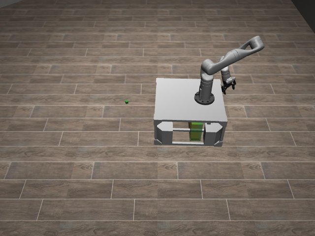

# Codex + GPT-6 Luna, effort medium — kinder-balance-beam-i00-standard

Recorded 2026-10-01 under protocol v1.0 (Harbor job `r50-kinder-standard`, trial `kinder-balance-beam-i00-standard__JmpJWmy`).

| | |
|---|---|
| result | **0** |
| mode | standard (`eai-standard/2.1`); reset budget 50 (the optional reset capability, PROTOCOL D1: reported separately from runs without reset); sensors: the robot cameras, wrist depth, odometry, joint encoders |
| agent | Harbor's `codex` agent, Codex 0.159.2, `openai/gpt-6-luna` through OpenRouter, reasoning effort medium, web search disabled (`scripts/kinder/configs/codex-openrouter.yaml`) |
| budget | 60 min; tokens 100M in / 10M out (PROTOCOL D10) |
| agent time | 1916 s |
| tokens in / out | 8,489,183 / 113,510 (within the budget) |
| cost | $0.16 |
| verifier | `{"success": 0, "live_success": 0, "replay_success": 0, "deterministic": 1, "finalized": 1, "missing_log": 0, "infra_error": 0, "grader_error": 0, "sim_crashed_on_call": 0, "n_actions": 1000, "sim_steps": 1000, "calls": 1596, "rows": 1000, "resets": 0, "reset_budget": 50, "sim_startups": 1, "elapsed_s": 1849.9, "video_rendered": 1}` |

## What happened

First move within a minute of its first request; 772 chunks in all, 1000 control steps over 1 episode (0 of its 50 resets used); its own labels include "Align approximately with initial forward direction", "Advance along initial scene direction to reveal distant terr", "Back away to approach cubes from their original side" (and 53 more). The graded episode 1 used up its 1000 control steps without reaching the goal (failed).
